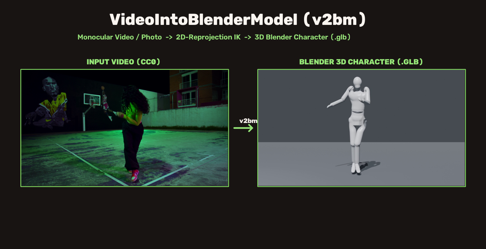
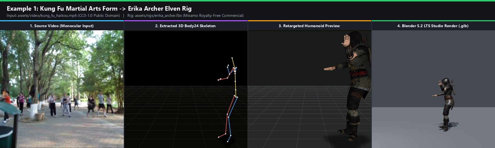
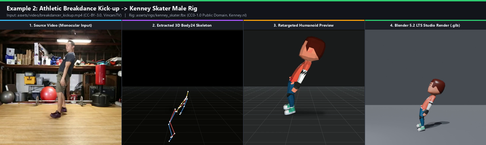
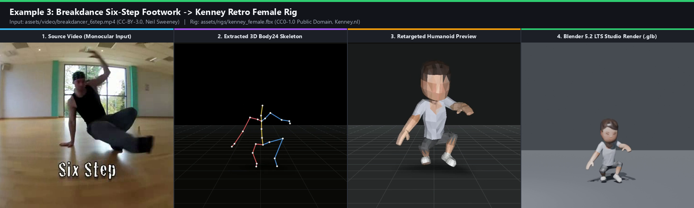
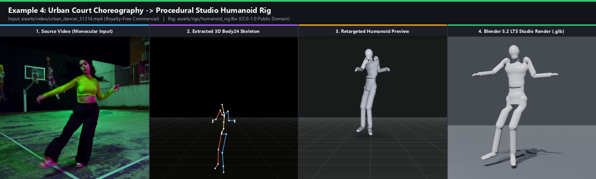
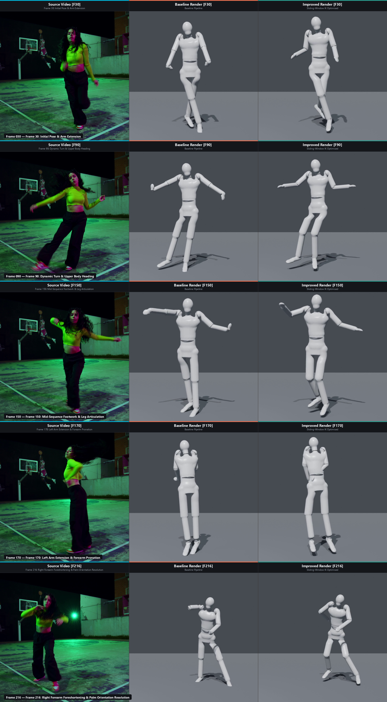
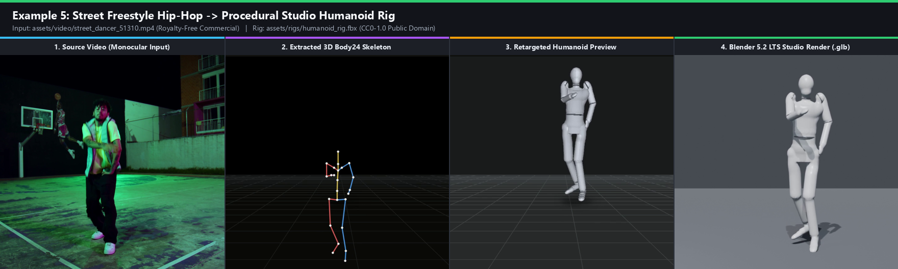
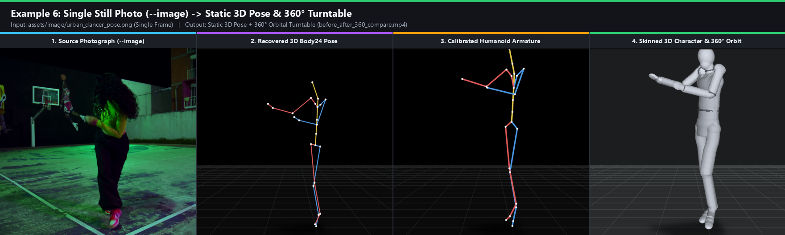
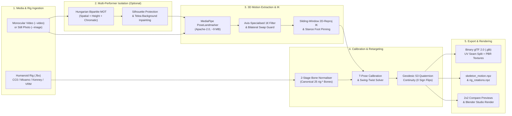

# VideoIntoBlenderModel (`v2bm`)

[](LICENSE)
[](assets/LICENCES.md)
[](pyproject.toml)
[](blender_extension/README.md)
[-8a2be2.svg)](#5-gltf-20-binary-export--uv-seam-splitting)



**Transfer human motion from any monocular video — or recover a full 3D pose from a single still photograph — directly onto a skinned, textured 3D humanoid character (`.glb`) ready for Blender, Unity, Godot, and Unreal Engine.**

`VideoIntoBlenderModel` (`v2bm`) is a lightweight, self-contained, **100% commercial-free** 3D character motion retargeting pipeline and **Blender 4.2+ / 5.2 LTS Extension**. Unlike traditional academic motion-capture pipelines that lock developers behind non-commercial research licences (such as SMPL, GVHMR, or WHAM), viral AGPL-3.0 detectors (YOLOv8), proprietary C++ SDKs, and multi-gigabyte checkpoint downloads, `v2bm` executes locally on CPU, CUDA, or Apple Silicon MPS using a **~9 MB Apache-2.0 pose landmarker**, a **sliding-window 2D-reprojection Inverse Kinematics (IK) trajectory optimiser**, and an **analytical swing-twist skeletal retargeter** with machine-precision forward kinematics ($\text{rest\_fk\_error} \le 10^{-12}$).

---

## Table of Contents

1. [Why `v2bm`? 100% Free for Commercial Use](#1-why-v2bm-100-free-for-commercial-use)
   - [Component-by-Component Commercial Licence Audit](#component-by-component-commercial-licence-audit)
   - [Comparison Against Traditional Academic Pipelines](#comparison-against-traditional-academic-pipelines)
   - [Automated AST & Licence Compliance Gate](#automated-ast--licence-compliance-gate)
2. [Showcase & Production Examples](#2-showcase--production-examples)
   - [Example 1: Kung Fu Martial Arts Forms → Erika Archer Elven Rig](#example-1-kung-fu-martial-arts-forms--erika-archer-elven-rig)
   - [Example 2: Athletic Breakdance Kick-up → Kenney Skater Male Rig](#example-2-athletic-breakdance-kick-up--kenney-skater-male-rig)
   - [Example 3: Breakdance Six-Step Footwork → Kenney Retro Female Rig](#example-3-breakdance-six-step-footwork--kenney-retro-female-rig)
   - [Example 4: Urban Basketball Court Choreography → Procedural Studio Humanoid Rig](#example-4-urban-basketball-court-choreography--procedural-studio-humanoid-rig)
   - [Example 5: Street Freestyle Hip-Hop → Procedural Studio Humanoid Rig](#example-5-street-freestyle-hip-hop--procedural-studio-humanoid-rig)
   - [Example 6: Single Still Photograph (`--image`) → Static 3D Pose & 360° Turntable](#example-6-single-still-photograph---image--static-3d-pose--360-turntable)
3. [System Architecture & Core Functionality](#3-system-architecture--core-functionality)
   - [End-to-End Pipeline Architecture](#end-to-end-pipeline-architecture)
   - [Multi-Person Tracking, Silhouette Protection & Background Inpainting](#31-multi-person-tracking-silhouette-protection--background-inpainting)
   - [Biomechanical Stabilisation & Adaptive One-Euro ($1\text{€}$) Filtering](#32-biomechanical-stabilisation--adaptive-one-euro-1-filtering)
   - [Sliding-Window 2D-Reprojection Inverse Kinematics (IK) Optimiser](#33-sliding-window-2d-reprojection-inverse-kinematics-ik-optimiser)
   - [Analytical Swing-Twist Retargeting & Geodesic Quaternion Continuity](#34-analytical-swing-twist-retargeting--geodesic-quaternion-continuity)
4. [Universal Humanoid Rig Compatibility & Bone Normalisation](#4-universal-humanoid-rig-compatibility--bone-normalisation)
5. [glTF 2.0 Binary Export (`.glb`) & UV Seam Splitting](#5-gltf-20-binary-export-glb--uv-seam-splitting)
6. [Installation & Quick Start](#6-installation--quick-start)
7. [Complete Command-Line Reference (`v2bm`)](#7-complete-command-line-reference-v2bm)
   - [`v2bm doctor` — Environment & Asset Preflight](#71-v2bm-doctor--environment--asset-preflight)
   - [`v2bm run` — Motion Extraction, Retargeting & Export](#72-v2bm-run--motion-extraction-retargeting--export)
   - [`v2bm isolate` — Multi-Performer Isolation & Background Inpainting](#73-v2bm-isolate--multi-performer-isolation--background-inpainting)
8. [Output Directory Structure & Artefacts](#8-output-directory-structure--artefacts)
9. [Blender 4.2+ / 5.2 LTS Extension & Studio Rendering](#9-blender-42--52-lts-extension--studio-rendering)
   - [Interactive Blender Viewport Add-on](#91-interactive-blender-viewport-add-on)
   - [Headless Blender Studio Rendering](#92-headless-blender-studio-rendering)
10. [Testing, Mathematical Verification & Quality Gates](#10-testing-mathematical-verification--quality-gates)
11. [Licence & Third-Party Notices](#11-licence--third-party-notices)

---

## 1. Why `v2bm`? 100% Free for Commercial Use

Most open-source video-to-3D human motion projects cannot legally be used in commercial video games, commercial animations, SaaS platforms, or monetised studio productions. They typically depend on **MPI SMPL / SMPL-X** body models (strictly restricted to non-commercial academic research), **GVHMR / HMR2.0 / WHAM** neural lifters (non-commercial licences), **Ultralytics YOLOv8** person detectors (AGPL-3.0 viral copyleft), or **Autodesk FBX SDK** binaries (proprietary redistribution limits).

**`VideoIntoBlenderModel` (`v2bm`) removes every single one of those legal and technical barriers.** Every line of source code, runtime library, neural weight checkpoint, bundled 3D character rig, and example motion clip in this repository is governed by an explicitly permissive, commercial-friendly licence (**Apache-2.0**, **BSD-3-Clause**, **MIT**, **CC0-1.0 Public Domain**, **CC-BY-3.0**, or **Royalty-Free Commercial**).

### Component-by-Component Commercial Licence Audit

| Layer / Component | Package / File Path | Author / Origin | SPDX Licence | Commercial Use | Royalty / Cost | Copyleft / Viral Risk |
| :--- | :--- | :--- | :---: | :---: | :---: | :---: |
| **Core Pipeline & CLI (`v2bm`)** | `v2bm/**`, `scripts/**` | VideoIntoBlenderModel Maintainers | `Apache-2.0` | **Permitted** | Free | None |
| **Blender 4.2+ Extension** | `blender_extension/v2bm_blender/**` | VideoIntoBlenderModel Maintainers | `Apache-2.0` | **Permitted** | Free | None |
| **3D Pose Estimation Engine** | `mediapipe` (`>=1.1.0`) | Google LLC | `Apache-2.0` | **Permitted** | Free | None |
| **Pose Landmarker Weights (~9 MB)** | `weights/mediapipe/pose_landmarker_full.task` | Google LLC | `Apache-2.0` | **Permitted** | Free | None |
| **Numerical Linear Algebra** | `numpy` (`>=1.26.0`) | NumPy Developers | `BSD-3-Clause` | **Permitted** | Free | None |
| **Non-Linear IK & Hungarian Solver** | `scipy` (`>=1.11.0`) | SciPy Developers | `BSD-3-Clause` | **Permitted** | Free | None |
| **Computer Vision & Inpainting** | `opencv-python` (`>=4.8.0`) | OpenCV Foundation / Intel | `Apache-2.0` | **Permitted** | Free | None |
| **Binary FBX Parser & Skinning** | `v2bm/rig/fbx_skeleton.py`, `skinned_mesh.py` | Pure Python (In-house Kaydara 7.4 parser) | `Apache-2.0` | **Permitted** | Free | None |
| **Binary glTF 2.0 (`.glb`) Exporter** | `v2bm/rig/gltf.py` | Pure Python (In-house glTF 2.0 writer) | `Apache-2.0` | **Permitted** | Free | None |
| **Default Studio Humanoid Rig** | `assets/rigs/humanoid_rig.fbx` | Procedural (`scripts/generate_humanoid_rig.py`) | `CC0-1.0` | **Permitted** | Free | None |
| **Kenney Skater Male Rig** | `assets/rigs/kenney_skater.fbx` + `.png` | Kenney Vleugels ([Kenney.nl](https://kenney.nl)) | `CC0-1.0` | **Permitted** | Free | None |
| **Kenney Retro Female Rig** | `assets/rigs/kenney_female.fbx` + `.png` | Kenney Vleugels ([Kenney.nl](https://kenney.nl)) | `CC0-1.0` | **Permitted** | Free | None |
| **Erika Archer Elven Rig** | `assets/rigs/erika_archer.fbx` | Adobe Mixamo | `Royalty-Free` | **Permitted** | Free | None |
| **Bundled Kung Fu Motion Video** | `assets/video/kung_fu_haikou.mp4` | Anna Frodesiak (Wikimedia Commons) | `CC0-1.0` | **Permitted** | Free | None |
| **Bundled Breakdance Videos** | `breakdancer_kickup.mp4`, `breakdancer_6step.mp4` | VincaniTV, Neil Sweeney (Wikimedia Commons) | `CC-BY-3.0` | **Permitted** | Free | None |
| **Bundled Urban & Street Videos** | `urban_dancer_51314.mp4`, `street_dancer_51310.mp4` | Royalty-Free Stock | `Royalty-Free` | **Permitted** | Free | None |

> [!IMPORTANT]
> **Full Provenance & Attribution Register**: Every bundled media clip and 3D character rig is documented with its creator, source URL, SPDX identifier, and attribution snippet in [`assets/LICENCES.md`](assets/LICENCES.md) (human-readable) and [`assets/licences.json`](assets/licences.json) (machine-readable). Third-party software notices are maintained in [`NOTICE.md`](NOTICE.md).

### Comparison Against Traditional Academic Pipelines

| Capability / Requirement | Traditional Academic Pipelines (SMPL / GVHMR / YOLOv8) | `VideoIntoBlenderModel` (`v2bm`) |
| :--- | :--- | :--- |
| **Commercial Game / Studio Use** | Prohibited without expensive custom commercial licensing | **100% Free & Permitted Out-of-the-Box** |
| **Copyleft (AGPL-3.0) Contamination** | Present via Ultralytics YOLOv8 person tracking | **Zero AGPL / GPL Code** |
| **Registration-Gated Body Models** | Requires manual sign-up for `SMPL_NEUTRAL.npz` | **None — Zero External Registration** |
| **Model Download Footprint** | ~5.0 GB of PyTorch checkpoints | **~9 MB (`pose_landmarker_full.task`)** |
| **PyTorch / C++ Build Isolation** | Fragile (`chumpy` / `pip` build-isolation failures) | **Pure `numpy`, `scipy`, `opencv-python`, `mediapipe`** |
| **Third-Party Rig Compatibility** | Hardcoded to single rig convention | **2-Stage Normalisation across 7+ Rig Standards** |
| **Texture & UV Export in `.glb`** | Untextured grey meshes or broken UV seams | **1:1 Seam-Split `TEXCOORD_0` + Embedded PBR PNG/JPEG** |

### Automated AST & Licence Compliance Gate

Commercial purity is not merely a documentation claim — it is enforced on every commit by [`tests/test_licence_and_deps.py`](tests/test_licence_and_deps.py), which:
1. Parses [`pyproject.toml`](pyproject.toml) to assert that every runtime and optional dependency belongs strictly to the approved permissive whitelist.
2. Walks the **Abstract Syntax Tree (AST)** of every Python file under [`v2bm/`](v2bm/) to guarantee zero imports of prohibited packages (`smplx`, `gvhmr`, `ultralytics`, `chumpy`, `torch`, `torchvision`).
3. Scans the entire repository tree to ensure zero non-commercial body model archives (`neutral_body_model.npz`, `*bodymodel*.npz`) exist on disk.
4. Cross-checks [`assets/licences.json`](assets/licences.json) and [`assets/LICENCES.md`](assets/LICENCES.md) against physical files on disk and runs preflight validation (`check_video`, `check_rig`) on every bundled asset.

---

## 2. Showcase & Production Examples

All six examples below are produced directly by `v2bm` using the commercial-free videos, still photographs, and 3D character rigs included in `assets/`. Each example demonstrates the complete four-stage progression:
1. **Monocular Input** (single-camera video or still photo),
2. **Extracted 3D `Body24` Skeleton** (biomechanically stabilised and IK-optimised in metre-scaled `+Y`-up space),
3. **Retargeted Humanoid Software Preview** (OpenCV diagnostic render), and
4. **Blender 5.2 LTS Studio Render** of the exported `character_animation.glb` with embedded PBR textures and studio lighting.

---

### Example 1: Kung Fu Martial Arts Forms → Erika Archer Elven Rig



A martial artist executing dynamic kung fu stances, deep horse-stance transitions, and high-velocity palm strikes in an outdoor park, retargeted onto **Erika Archer**, a multi-mesh high-resolution elven archer rig (67 total bones, 4 PBR-textured sub-meshes: body, tunic/boots, eyes, and eyelashes).

```bash
v2bm run --video assets/video/kung_fu_haikou.mp4 --rig assets/rigs/erika_archer.fbx
```

| Metric / Property | Value |
| :--- | :--- |
| **Input Video** | `assets/video/kung_fu_haikou.mp4` (`720×480` @ `29.97 fps`, `149 frames`, `CC0-1.0` Public Domain) |
| **Target Character Rig** | `assets/rigs/erika_archer.fbx` (`67 bones`, `22 controlled core bones`, embedded PBR PNG textures, `Royalty-Free`) |
| **Rest Forward Kinematics Error** | $7.61 \times 10^{-11}$ (threshold $< 10^{-4}$) |
| **Temporal Continuity** | `0` discrete $180^\circ$ twist jumps · `0` antipodal quaternion sign flips |

---

### Example 2: Athletic Breakdance Kick-up → Kenney Skater Male Rig



An explosive breakdance floor-to-standing kick-up freeze transition (`1920×1080` Full HD), retargeted onto **Kenney Skater Male** (`CC0-1.0` Public Domain) with conformal UV seam splitting (`TEXCOORD_0`) and an embedded `512×512` diffuse colour atlas.

```bash
v2bm run --video assets/video/breakdancer_kickup.mp4 --rig assets/rigs/kenney_skater.fbx
```

| Metric / Property | Value |
| :--- | :--- |
| **Input Video** | `assets/video/breakdancer_kickup.mp4` (`1920×1080` @ `24.0 fps`, `67 frames`, `CC-BY-3.0` by VincaniTV) |
| **Target Character Rig** | `assets/rigs/kenney_skater.fbx` (`25 bones`, `804 vertices`, `1,604 triangles`, `CC0-1.0` by Kenney.nl) |
| **Rest FK / Skinning Error** | $\text{rest\_fk\_error} = 1.73 \times 10^{-12}$ · $\text{rest\_skin\_error} = 1.03 \times 10^{-5}\text{ cm}$ |
| **Temporal Continuity** | `0` discrete $180^\circ$ twist jumps · `0` antipodal quaternion sign flips |

---

### Example 3: Breakdance Six-Step Footwork → Kenney Retro Female Rig



A foundational breakdance six-step rotational floor sequence featuring rapid lower-body crossovers, deep squat articulation, and continuous ground support, retargeted onto **Kenney Retro Human Female** (`CC0-1.0` Public Domain).

```bash
v2bm run --video assets/video/breakdancer_6step.mp4 --rig assets/rigs/kenney_female.fbx
```

| Metric / Property | Value |
| :--- | :--- |
| **Input Video** | `assets/video/breakdancer_6step.mp4` (`640×360` @ `30.0 fps`, `120 frames`, `CC-BY-3.0` by Neil Sweeney) |
| **Target Character Rig** | `assets/rigs/kenney_female.fbx` (`25 bones`, `804 vertices`, `1,604 triangles`, `CC0-1.0` by Kenney.nl) |
| **Rest FK / Skinning Error** | $\text{rest\_fk\_error} = 1.73 \times 10^{-12}$ · $\text{rest\_skin\_error} = 1.03 \times 10^{-5}\text{ cm}$ |
| **Temporal Continuity** | `0` discrete $180^\circ$ twist jumps · `0` antipodal quaternion sign flips |

---

### Example 4: Urban Basketball Court Choreography → Procedural Studio Humanoid Rig



A 240-frame (`10.0 s`) urban street-dance routine filmed on a night-time basketball court under strong neon lighting, retargeted onto the default **Procedural Studio Humanoid Rig** (`assets/rigs/humanoid_rig.fbx`, `CC0-1.0` Public Domain).

```bash
v2bm run --video assets/video/urban_dancer_51314.mp4 --rig assets/rigs/humanoid_rig.fbx
```

| Metric / Property | Value |
| :--- | :--- |
| **Input Video** | `assets/video/urban_dancer_51314.mp4` (`23.98 fps`, `240 frames`, `Royalty-Free Commercial`) |
| **Target Character Rig** | `assets/rigs/humanoid_rig.fbx` (`25 bones`, dual meshes `Alpha_Surface` + `Alpha_Joints`, `CC0-1.0`) |
| **Rest FK / Skinning Error** | $\text{rest\_fk\_error} = 0.0$ · $\text{rest\_skin\_error} = 3.18 \times 10^{-14}\text{ cm}$ |
| **Temporal Continuity** | `0` discrete $180^\circ$ twist jumps · `0` antipodal quaternion sign flips |

<details>
<summary><strong>View 5-Row Keyframe Comparison Grid: Baseline vs Sliding-Window 2D-Reprojection IK Optimiser (Frames 30, 90, 150, 170, 216)</strong></summary>

<br>

The grid below (`scripts/generate_comparisons.py`) illustrates how the **Sliding-Window 2D-Reprojection IK Optimiser** and **Two-Vector Forearm/Hand Solver** resolve severe monocular depth foreshortening (such as Frame 216, where the performer's right forearm aims directly toward the camera lens) while preserving rigid bone lengths and natural wrist pronation:



</details>

---

### Example 5: Street Freestyle Hip-Hop → Procedural Studio Humanoid Rig



A 240-frame (`10.0 s`) freestyle hip-hop performance featuring fast upper-body isolations, rhythmic knee bounces, and lateral stepping, retargeted onto `humanoid_rig.fbx`.

```bash
v2bm run --video assets/video/street_dancer_51310.mp4 --rig assets/rigs/humanoid_rig.fbx
```

| Metric / Property | Value |
| :--- | :--- |
| **Input Video** | `assets/video/street_dancer_51310.mp4` (`23.98 fps`, `240 frames`, `Royalty-Free Commercial`) |
| **Target Character Rig** | `assets/rigs/humanoid_rig.fbx` (`25 bones`, `CC0-1.0` Public Domain) |
| **Rest FK / Skinning Error** | $\text{rest\_fk\_error} = 0.0$ · $\text{rest\_skin\_error} = 3.18 \times 10^{-14}\text{ cm}$ |
| **Temporal Continuity** | `0` discrete $180^\circ$ twist jumps · `0` antipodal quaternion sign flips |

---

### Example 6: Single Still Photograph (`--image`) → Static 3D Pose & 360° Turntable



Passing `--image` recovers a complete 3D human skeletal pose from a **single still photograph**, transfers it onto any humanoid rig, exports a posed `.glb` character, and renders both a 2×2 diagnostic sheet (`images/compare.png`) and a **180-frame $360^\circ$ orbital turntable video** (`images/before_after_360_compare.mp4` orbiting at $10^\circ$ camera elevation).

```bash
v2bm run --image assets/image/urban_dancer_pose.png --rig assets/rigs/humanoid_rig.fbx
```

---

## 3. System Architecture & Core Functionality

### End-to-End Pipeline Architecture



### 3.1. Multi-Person Tracking, Silhouette Protection & Background Inpainting

Real-world dance and action videos frequently contain background spectators, duo choreography, or group formations. While single-person mode (`v2bm run` without `--target-subject`) rejects multi-person clips during preflight so background bystanders never corrupt your motion capture, [`v2bm/isolate.py`](v2bm/isolate.py) allows you to **extract any specific performer from a multi-person video** via `--target-subject`:

- **Declarative Target Selectors**: Choose `--target-subject` from `primary` (largest bounding-box area), `auto`, `left` (leftmost performer), `right` (rightmost performer), `tallest`, or `shortest`.
- **Hungarian Bipartite Multi-Object Tracking (`MultiPersonTracker`)**: Matches up to 4 concurrent human poses frame-to-frame using `scipy.optimize.linear_sum_assignment` over a composite cost matrix combining velocity-predicted spatial centroid distance ($50\%$), torso `5×5` BGR chromatic signature distance ($30\%$), and vertical height ratio consistency ($20\%$).
- **Swap & Crossing Invariance**: Maintains locked identity even when performers cross paths laterally (`left` $\leftrightarrow$ `right`) or pass behind one another in depth.
- **Dynamic Silhouette Protection (`build_removal_mask`)**: Dilates non-target segmentation masks (`17 px` elliptical structuring element) to erase stray hair and fingertips, then **strictly subtracts the dilated target performer mask (`7 px` protection buffer)** so inpainting never clips the target performer's limbs during close interaction.
- **Fast Marching Telea Inpainting & Audio Muxing**: Reconstructs occluded background pixels via `cv2.INPAINT_TELEA` and multiplexes the original audio stream into the isolated video via `ffmpeg`.

### 3.2. Biomechanical Stabilisation & Adaptive One-Euro ($1\text{€}$) Filtering

Raw monocular 3D landmarks suffer from depth ($Z$) jitter, perspective foreshortening, and occasional left/right limb confusion during fast spins. [`v2bm/stabilize_kp2d.py`](v2bm/stabilize_kp2d.py) applies a five-stage biomechanical filter bank:

1. **Axis-Specialised Adaptive One-Euro ($1\text{€}$) Filter**: Modulates the low-pass cutoff frequency dynamically with landmark speed ($f_c = f_{c,\min} + \beta \|\hat{\dot{\mathbf{x}}}_t\|$). Lateral/vertical ($X, Y$) coordinates use high responsiveness ($f_{c,\min} = 1.0\text{ Hz}, \beta = 0.005$), while monocular depth ($Z$) applies stronger noise suppression ($f_{c,\min} = 0.5\text{ Hz}, \beta = 0.05$), achieving $\ge 60\%$ reduction in Mean Squared Jerk (MSJ).
2. **Bilateral Limb Swap Guard**: Monitors shoulder and hip lateral vector orientation with temporal hysteresis to prevent instantaneous left/right limb swaps during $180^\circ$ turns.
3. **Anatomical Hinge Range-of-Motion Clamping**: Constrains knees and elbows to physiological flexion intervals ($0^\circ\text{–}145^\circ$) and prevents hyper-extension inversion.
4. **Camera-Space Root Trajectory Estimation**: Estimates metric 3D root displacement from apparent torso scale relative to temporal median anatomical bone lengths.
5. **Stance-Phase Ground Pinning**: Detects stationary support feet and pins the character's lowest contact point to the ground plane ($Y = 0$) to prevent vertical floating and floor penetration.

### 3.3. Sliding-Window 2D-Reprojection Inverse Kinematics (IK) Optimiser

Implemented in [`v2bm/ik_optimiser.py`](v2bm/ik_optimiser.py), the trajectory optimiser refines the 24-joint `Body24` motion over overlapping temporal windows (window length $W = 11$ frames, stride $S = 5$ frames) blended with smooth Hann/cosine weights. Using `scipy.optimize.least_squares`, each window jointly minimises:

$$E(\mathbf{P}) = w_{\text{2D}} E_{\text{reproj}} + w_{\text{3D}} E_{\text{prior}} + w_{\text{bone}} E_{\text{length}} + w_{\text{smooth}} E_{\text{accel}} + w_{\text{jerk}} E_{\text{jerk}} + w_{\text{anat}} E_{\text{hinge}}$$

- **Foreshortening-Aware Weighting**: When a limb points directly toward or away from the camera, monocular depth confidence drops; the optimiser automatically downweights noisy $Z$ priors and relies on rigid bone-length constraints ($w_{\text{bone}} = 25.0$) and temporal continuity to recover true 3D limb extension.
- **Exact Hierarchical Bone Projection**: After window blending, a final root-to-leaf hierarchical projection enforces exact temporal median bone lengths across every frame ($< 10^{-4}\text{ m}$ deviation).

### 3.4. Analytical Swing-Twist Retargeting & Geodesic Quaternion Continuity

Implemented across [`v2bm/rig/tpose_calibration.py`](v2bm/rig/tpose_calibration.py), [`v2bm/rig/retarget.py`](v2bm/rig/retarget.py), and [`v2bm/rig/kinematics.py`](v2bm/rig/kinematics.py):

- **Automatic T-Pose Calibration**: Inspects the target FBX armature's bind pose (`PreRotation`, `Lcl Translation`, `Lcl Rotation`) and computes rest-relative coordinate frames for all 25 core humanoid bones.
- **Analytical Swing-Twist Decomposition**: Solves bone orientations analytically from parent-to-child aim vectors and anatomical plane normals (pelvis, thorax, clavicles, limbs, and two-vector hand/wrist orientation).
- **Zero Twist Discontinuities (`twist_events = 0`)**: Resolves discrete $180^\circ$ axial twist ambiguities by selecting the twist branch minimising Frobenius rotation distance to the preceding frame (`pick_closest_aim_twist`).
- **Geodesic $S^3$ Quaternion Continuity (`quat_sign_flips = 0`)**: Because unit quaternions $\mathbf{q}$ and $-\mathbf{q}$ represent the same 3D rotation in $\mathrm{SO}(3)$, naive frame-by-frame conversion can flip signs between adjacent keyframes, causing severe interpolation spikes in game engines. `continue_quaternion` enforces $\mathbf{q}_t \cdot \mathbf{q}_{t-1} \ge 0$ across every bone track.

---

## 4. Universal Humanoid Rig Compatibility & Bone Normalisation

You do not need to manually rename bones in Blender before running `v2bm`. [`v2bm/rig/fbx_skeleton.py`](v2bm/rig/fbx_skeleton.py) implements a **Two-Stage Bone Alias Normaliser** (`normalize_rig_prefix` and `canonicalize_bone_name`) that automatically maps third-party character rigs onto the canonical 25-bone `rig:*` hierarchy:

1. **Stage 1 — Namespace Prefix Stripping**: Automatically strips prefixes injected by DCC exporters and character creation tools: `rig:`, `mixamorig:`, `mixamorig1:`, `Armature|`, `Armature_`, `Bip01_`, `Bip01_L_`, `J_Bip_`, and `Character_`.
2. **Stage 2 — Case-Insensitive Anatomical Alias Mapping**: Maps over **100 bone naming conventions** across major open-source and commercial character ecosystems:

| Canonical `v2bm` Bone | Procedural / Mixamo (`rig:` / `mixamorig:`) | Kenney / Quaternius / Bare | Unreal Engine / MakeHuman (`MPFB2`) | VRM / Unity Humanoid (`J_Bip_`) | 3ds Max Biped (`Bip01_`) |
| :--- | :--- | :--- | :--- | :--- | :--- |
| `rig:Hips` | `Hips` | `Hips`, `Pelvis`, `Root` | `pelvis`, `root` | `J_Bip_C_Hips` | `Bip01_Pelvis` |
| `rig:Spine` | `Spine` | `Spine`, `Lower_Spine`, `Abdomen` | `spine_01`, `spine01` | `J_Bip_C_Spine` | `Bip01_Spine` |
| `rig:Spine1` | `Spine1` | `Chest`, `Middle_Spine` | `spine_02`, `spine02` | `J_Bip_C_Chest` | `Bip01_Spine1` |
| `rig:Spine2` | `Spine2` | `UpperChest`, `Upper_Chest` | `spine_03`, `spine03` | `J_Bip_C_UpperChest` | `Bip01_Spine2` |
| `rig:Neck` | `Neck` | `Neck`, `Lower_Neck` | `neck_01`, `neck01` | `J_Bip_C_Neck` | `Bip01_Neck` |
| `rig:Head` | `Head` | `Head` | `head`, `head_01` | `J_Bip_C_Head` | `Bip01_Head` |
| `rig:LeftShoulder` | `LeftShoulder` | `Shoulder.L`, `Clavicle.L`, `Collar.L` | `clavicle_l`, `l_clavicle` | `J_Bip_L_Shoulder` | `Bip01_L_Clavicle` |
| `rig:LeftArm` | `LeftArm` | `UpperArm.L`, `Arm.L`, `LeftUpperArm` | `upperarm_l`, `l_upper_arm` | `J_Bip_L_UpperArm` | `Bip01_L_UpperArm` |
| `rig:LeftForeArm` | `LeftForeArm` | `LowerArm.L`, `ForeArm.L` | `lowerarm_l`, `l_forearm` | `J_Bip_L_LowerArm` | `Bip01_L_Forearm` |
| `rig:LeftHand` | `LeftHand` | `Hand.L`, `Wrist.L`, `LeftWrist` | `hand_l`, `wrist_l` | `J_Bip_L_Hand` | `Bip01_L_Hand` |
| `rig:LeftUpLeg` | `LeftUpLeg` | `UpperLeg.L`, `Thigh.L`, `Hip.L` | `thigh_l`, `upperleg_l` | `J_Bip_L_UpperLeg` | `Bip01_L_Thigh` |
| `rig:LeftLeg` | `LeftLeg` | `LowerLeg.L`, `Calf.L`, `Shin.L`, `Knee.L` | `calf_l`, `shin_l`, `lowerleg_l` | `J_Bip_L_LowerLeg` | `Bip01_L_Calf` |
| `rig:LeftFoot` | `LeftFoot` | `Foot.L`, `Ankle.L` | `foot_l`, `ankle_l` | `J_Bip_L_Foot` | `Bip01_L_Foot` |
| `rig:LeftToeBase` | `LeftToeBase` | `Toe.L`, `Toes.L`, `Ball.L` | `ball_l`, `toe_l` | `J_Bip_L_ToeBase` | `Bip01_L_Toe0` |

*(Right-side limbs follow identical symmetric rules for `.R`, `_r`, `Right*`, `J_Bip_R_*`, and `Bip01_R_*`. Finger chains and accessory bones are preserved untouched in their rest pose.)*

---

## 5. glTF 2.0 Binary Export (`.glb`) & UV Seam Splitting

[`v2bm/rig/gltf.py`](v2bm/rig/gltf.py) writes self-contained binary **glTF 2.0 (`.glb`)** files directly from Python with zero external 3D converter dependencies:

- **1:1 Vertex-UV Seam Splitting**: FBX files store UV coordinates per polygon-vertex (`(F, 3, 2)`), allowing a single 3D vertex on a clothing seam to carry multiple distinct UV coordinates. Because glTF 2.0 requires a strict 1:1 correspondence between vertex positions (`POSITION`), normals (`NORMAL`), skinning joints (`JOINTS_0`), skinning weights (`WEIGHTS_0`), and texture coordinates (`TEXCOORD_0`), `v2bm` automatically splits vertices along UV seams while preserving exact linear blend skinning weights.
- **Embedded PBR Base-Colour Textures**: Extracts embedded FBX `Video` media chunks (or companion `.png` / `.jpg` texture atlases alongside the `.fbx`), packs the raw image bytes into the `.glb` binary buffer (`bufferViews`, `images`, `textures`, `samplers`), and binds them to `pbrMetallicRoughness.baseColorTexture`.
- **Dual-Path Rendering Compatibility**: While exporting `TEXCOORD_0` and PBR textures into the `.glb` for Blender, Unity, Godot, and Unreal Engine, `v2bm` simultaneously retains per-face diffuse colours (`mesh.face_colors`) in memory so the fast OpenCV software preview renderer (`v2bm/videos.py`) operates without overhead.

---

## 6. Installation & Quick Start

### Prerequisites

- **Python**: `3.10+` (`3.10` to `3.13` supported; tested on Windows, macOS, and Linux).
- **FFmpeg** *(recommended)*: Used to encode browser-compatible `H.264` (`yuv420p`) `.mp4` videos and preserve source audio tracks.
  - **Windows**: `winget install Gyan.FFmpeg` or `choco install ffmpeg`
  - **macOS**: `brew install ffmpeg`
  - **Ubuntu / Debian**: `sudo apt install ffmpeg`
  *(Note: `v2bm` still runs without FFmpeg, falling back to silent OpenCV `mp4v` encoding.)*

### 1. Clone & Install

**Linux / macOS:**

```bash
git clone https://github.com/your-org/VideoIntoBlenderModel.git
cd VideoIntoBlenderModel
python3 -m venv venv
source venv/bin/activate
pip install --upgrade pip
pip install -e .
```

**Windows (PowerShell):**

```powershell
git clone https://github.com/your-org/VideoIntoBlenderModel.git
cd VideoIntoBlenderModel
python -m venv venv
.\venv\Scripts\python.exe -m pip install --upgrade pip
.\venv\Scripts\python.exe -m pip install -e .
```

> [!TIP]
> On the first run, `v2bm` automatically verifies or downloads the lightweight Google MediaPipe Pose Landmarker weight file (`weights/mediapipe/pose_landmarker_full.task`, **~9 MB**, Apache-2.0 licence). No account registration or manual model download is required.

### 2. Verify Your Environment (`v2bm doctor`)

Run the diagnostic check to verify all Python dependencies, bundled character rigs, input videos/images, MediaPipe weights, and FFmpeg availability:

```bash
v2bm doctor
```

### 3. Run Your First Motion Transfer

With no flags, `v2bm run` automatically selects the most recently added video in `assets/video/` and retargets it onto the default CC0 humanoid rig (`assets/rigs/humanoid_rig.fbx`):

```bash
v2bm run
```

Or specify any video and character rig explicitly:

```bash
# Retarget Kung Fu martial arts onto the Erika Archer elven rig:
v2bm run --video assets/video/kung_fu_haikou.mp4 --rig assets/rigs/erika_archer.fbx

# Retarget Breakdance Kick-up onto the Kenney Skater Male rig:
v2bm run --video assets/video/breakdancer_kickup.mp4 --rig assets/rigs/kenney_skater.fbx

# Retarget Breakdance Six-Step onto the Kenney Retro Female rig:
v2bm run --video assets/video/breakdancer_6step.mp4 --rig assets/rigs/kenney_female.fbx
```

### 4. Reuse Extracted Motion on Another Character in Seconds (`--skeleton`)

Extracting and optimising 3D human motion from video is the most compute-intensive step. Once a video has been processed once, reuse its `skeleton_motion.npz` to retarget the exact same motion onto a different character rig in **a few seconds**:

```bash
v2bm run \
  --skeleton outputs/20261015_205222_kung_fu_haikou/skeleton_motion.npz \
  --rig assets/rigs/kenney_skater.fbx
```

---

## 7. Complete Command-Line Reference (`v2bm`)

The `v2bm` CLI (or `python -m v2bm.cli`) provides three subcommands: **`doctor`**, **`run`**, and **`isolate`**.

### 7.1. `v2bm doctor` — Environment & Asset Preflight

```bash
v2bm doctor
```

Inspects and validates:
- Default CC0 rig (`assets/rigs/humanoid_rig.fbx`) and all additional `.fbx` rigs in `assets/rigs/` (verifying binary Kaydara FBX header, 25 core humanoid bones, and mesh skinning).
- All videos in `assets/video/` and still photos in `assets/image/` (verifying readability and single-person framing).
- Python packages (`numpy`, `cv2`, `mediapipe`, `scipy`).
- Local inference weights (`weights/mediapipe/pose_landmarker_full.task`).
- `ffmpeg` availability on `PATH`.

### 7.2. `v2bm run` — Motion Extraction, Retargeting & Export

```bash
v2bm run [OPTIONS]
```

| Flag / Option | Default | Description |
| :--- | :--- | :--- |
| `--video PATH` | Latest in `assets/video/` | Input motion video clip (`.mp4`, `.mov`, `.webm`, `.avi`). Cannot be combined with `--image`. |
| `--image [PATH]` | Latest in `assets/image/` | Input single-person still photograph (`.png`, `.jpg`, `.webp`, `.bmp`). Recovers a static 3D pose and renders a $360^\circ$ turntable. |
| `--rig PATH` | `assets/rigs/humanoid_rig.fbx` | Target humanoid character `.fbx` file (FBX Binary format, T-pose). |
| `--skeleton PATH` | `None` | Path to a previous run's `skeleton_motion.npz`. Skips video extraction and immediately retargets onto `--rig`. |
| `--target-subject CHOICE` | `None` | Automatically isolates and tracks a specific performer in multi-person videos (`auto`, `primary`, `left`, `right`, `tallest`, `shortest`) and inpaints all other people before extraction. |
| `--device {cpu,cuda,mps}` | `cpu` | Execution device for pose extraction (`cpu`, `cuda`, or `mps`). |
| `--output-dir PATH` | Timestamped `outputs/<run>/` | Write outputs into a specific directory path instead of generating a timestamped folder. |
| `--progress-jsonl PATH` | `None` | Append structured JSON Lines (`{"stage": ..., "progress": ..., "message": ...}`) progress events to `PATH` (used by automation and the Blender Extension). |
| `--no-preview` | `False` | Skip rendering preview `.mp4` / `.png` files; still writes `character_animation.glb`, `.npz` archives, and `run.json`. |

### 7.3. `v2bm isolate` — Multi-Performer Isolation & Background Inpainting

Run standalone multi-person tracking and background inpainting to produce a clean single-performer video clip:

```bash
v2bm isolate \
  --video path/to/multi_person_dance.mp4 \
  --output outputs/isolated_performer.mp4 \
  --target-subject left
```

| Flag / Option | Default | Description |
| :--- | :--- | :--- |
| `--video PATH` | *(Required)* | Path to input multi-person video file. |
| `--output PATH` | *(Required)* | Destination path for the isolated, background-inpainted `.mp4` video. |
| `--target-subject CHOICE` | `primary` | Performer selection policy on initial detection (`auto`, `primary`, `left`, `right`, `tallest`, `shortest`). |

---

## 8. Output Directory Structure & Artefacts

Each run writes a self-contained directory under `outputs/<YYYYMMDD_HHMMSS>_<source_name>/`:

```text
outputs/20261015_205222_kung_fu_haikou/
├── run.json                            # Full provenance report, timings, FPS, FK/skinning errors, & continuity metrics
├── skeleton_motion.npz                 # 3D human skeleton trajectory: shape (F, 24, 3) in Y-up metres (reuse with --skeleton)
├── rig_rotations.npz                   # Per-bone quaternion rotations (wxyz) & root translations in cm
├── character_animation.glb             # Skinned, UV-textured glTF 2.0 character + keyframed animation clip
├── cache/                              # Extraction intermediates & isolated video cache (when --target-subject is used)
└── videos/                             # (For --video runs)
    ├── human_skeleton.mp4              # 3D Body24 human skeleton preview
    ├── humanoid_skeleton.mp4           # Calibrated 25-bone humanoid rig skeleton preview
    ├── humanoid_character.mp4          # Software-rendered skinned character preview
    └── compare.mp4                     # Synchronised 2×2 quad comparison (Original / Rig Skeleton / Human Skeleton / Character)
```

When running on a **still photograph (`--image`)**, `images/` is written instead of `videos/`:

```text
└── images/                             # (For --image runs)
    ├── human_skeleton.png              # Recovered 3D Body24 pose
    ├── humanoid_skeleton.png           # Retargeted humanoid rig skeleton
    ├── humanoid_character.png          # Posed, skinned 3D humanoid character
    ├── compare.png                     # 2×2 quad diagnostic sheet
    └── before_after_360_compare.mp4    # Side-by-side: original photo (left) vs 360° orbital turntable at 10° elevation (right)
```

### Importing `character_animation.glb` into Blender Manually

1. Open Blender and choose **File → Import → glTF 2.0 (`.glb`/`.gltf`)**.
2. In the Outliner, hide the bone display helper (`Icosphere`) and the `Armature` wireframes if visible, leaving the skinned character mesh(es) visible.
3. Set the scene **Frame Rate (FPS)** and timeline **End Frame** to match `fps` and `n_frames` recorded in `run.json` so playback speed matches the source video 1:1.

---

## 9. Blender 4.2+ / 5.2 LTS Extension & Studio Rendering

### 9.1. Interactive Blender Viewport Add-on

`VideoIntoBlenderModel` includes a native **Blender 4.2+ / 5.2 LTS Extension** ([`blender_extension/v2bm_blender/`](blender_extension/v2bm_blender/)) that provides a complete sidebar panel inside the 3D Viewport (`N` key → **VideoIntoBlenderModel** tab).

- **Zero Interpreter Pollution**: Blender's bundled Python never loads `mediapipe`, `opencv`, or `scipy`. Instead, the add-on spawns your external `venv` Python interpreter asynchronously, streams progress updates via `--progress-jsonl`, keeps the Blender UI responsive with a live progress bar and **Cancel** button, and automatically imports and frames the generated `character_animation.glb` upon completion.
- **Build & Install the Extension**:
  ```bash
  python scripts/package_blender_extension.py
  # Produces dist/v2bm-0.1.0.zip
  ```
  In Blender: **Edit → Preferences → Get Extensions → ∨ (top-right dropdown) → Install from Disk…**, select `dist/v2bm-0.1.0.zip`, and enable **VideoIntoBlenderModel**.
- Full step-by-step instructions: [`blender_extension/README.md`](blender_extension/README.md).

### 9.2. Headless Blender Studio Rendering

To render high-definition studio-lit `.mp4` animations of any exported `character_animation.glb` (with three-point studio lighting, ground plane shadow catcher, automatic camera framing, and audio muxing), use [`scripts/render_blender_animation.py`](scripts/render_blender_animation.py):

**Linux / macOS:**

```bash
blender --background --python scripts/render_blender_animation.py -- \
  --glb outputs/20261015_205222_kung_fu_haikou/character_animation.glb \
  --output outputs/20261015_205222_kung_fu_haikou/videos/blender_character_render.mp4 \
  --log outputs/20261015_205222_kung_fu_haikou/videos/blender_render.log
```

**Windows (PowerShell):**

```powershell
Start-Process -FilePath "$env:LOCALAPPDATA\Microsoft\WindowsApps\blender-launcher.exe" `
  -ArgumentList "--background", "--python", "scripts\render_blender_animation.py", "--", `
    "--glb", "outputs\20261015_205222_kung_fu_haikou\character_animation.glb", `
    "--output", "outputs\20261015_205222_kung_fu_haikou\videos\blender_character_render.mp4", `
    "--log", "outputs\20261015_205222_kung_fu_haikou\videos\blender_render.log" -Wait
```

---

## 10. Testing, Mathematical Verification & Quality Gates

The repository includes a comprehensive four-tier automated test suite under [`tests/`](tests/) (documented in [`TEST_INFRA.md`](TEST_INFRA.md)):

| Test Suite | Verification Scope & Mathematical Bounds |
| :--- | :--- |
| [`tests/test_licence_and_deps.py`](tests/test_licence_and_deps.py) | **Tier 1 — Licence & Dependency Gate**: Verifies `pyproject.toml`, AST imports across `v2bm/`, absence of non-commercial assets, and completeness of `assets/licences.json`. |
| [`tests/test_fbx_aliases.py`](tests/test_fbx_aliases.py) | **Tier 1 — Universal Bone Normalisation**: Verifies two-stage prefix stripping and alias canonicalisation across Mixamo, Kenney, Quaternius, MakeHuman, VRM, Unreal, and 3ds Max Biped naming schemes. |
| [`tests/test_fk_skin.py`](tests/test_fk_skin.py) | **Tier 2 — Kinematics & Skinning Precision**: Proves machine-precision rest forward kinematics ($\text{rest\_fk\_error} \le 10^{-12}$) and sub-micrometre linear blend skinning ($\text{rest\_skin\_error} < 10^{-3}\text{ cm}$). |
| [`tests/test_retarget_stability.py`](tests/test_retarget_stability.py) | **Tier 2 — Retargeting Stability**: Proves zero discrete $180^\circ$ twist jumps ($\text{twist\_events} = 0$) and zero antipodal quaternion sign flips ($\text{quat\_sign\_flips} = 0$). |
| [`tests/test_one_euro_filter.py`](tests/test_one_euro_filter.py) | **Tier 2 — Adaptive Filtering**: Verifies $\ge 60\%$ Mean Squared Jerk (MSJ) acceleration noise reduction. |
| [`tests/test_ik_optimiser.py`](tests/test_ik_optimiser.py) | **Tier 2 — Sliding-Window IK**: Verifies rigid bone length invariance ($< 10^{-4}\text{ m}$), anatomical hinge clamping, and foreshortening recovery. |
| [`tests/test_glb_textures.py`](tests/test_glb_textures.py) | **Tier 2 — Binary `.glb` & UV Seam Splitting**: Verifies 1:1 vertex-UV seam splitting (`TEXCOORD_0`), binary `bufferViews`, embedded PNG/JPEG textures, and `baseColorTexture` materials. |
| [`tests/test_isolate.py`](tests/test_isolate.py) | **Tier 2 — Multi-Performer Isolation**: Verifies Hungarian bipartite tracking across lateral swaps and depth crossings, plus target silhouette protection during inpainting. |
| [`tests/test_checks.py`](tests/test_checks.py) & [`tests/test_cli.py`](tests/test_cli.py) | **Tier 3 — End-to-End CLI Execution**: Verifies preflight checks, `v2bm doctor`, `v2bm run --video`, and `v2bm run --image`. |
| [`tests/test_blender_verification.py`](tests/test_blender_verification.py) | **Tier 4 — Headless Blender Audit**: Imports exported `.glb` files in headless Blender (`scripts/verify_blender_glb.py`) and verifies armature hierarchy, skinned modifiers, and keyframed F-curves. |

Run the full test suite:

```bash
# Linux / macOS
./venv/bin/pytest -v

# Windows PowerShell
.\venv\Scripts\pytest.exe -v
```

---

## 11. Licence & Third-Party Notices

- **Source Code**: Licensed under the **Apache License, Version 2.0** (see [`LICENSE`](LICENSE)).
- **Third-Party Software Notices**: See [`NOTICE.md`](NOTICE.md) for attributions covering Google MediaPipe (`Apache-2.0`), OpenCV (`Apache-2.0`), NumPy (`BSD-3-Clause`), and SciPy (`BSD-3-Clause`).
- **Media & 3D Character Rig Register**: See [`assets/LICENCES.md`](assets/LICENCES.md) and [`assets/licences.json`](assets/licences.json) for full provenance and licence verification of all bundled videos and character rigs.
