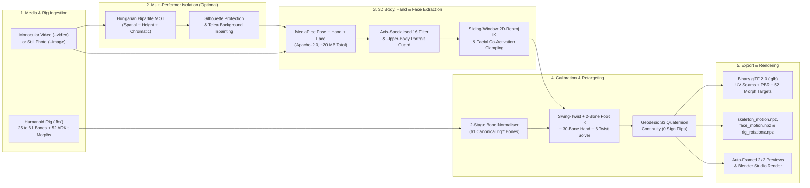

# VideoIntoBlenderModel (`v2bm`)

[](LICENSE)
[](assets/LICENCES.md)
[](pyproject.toml)
[](blender_extension/README.md)
[](#7-universal-humanoid-rig-compatibility--bone-normalisation)
[](#86-optional-nvidia-cuda-gpu-acceleration-across-all-pipeline-stages)
[-8a2be2.svg)](#9-gltf-20-binary-export-glb-morph-targets--uv-seam-splitting)
[](https://github.com/sponsors/s0ck3t)


**Transfer full-body human motion, 30-bone hand & finger articulation, and 52 ARKit facial expressions from any monocular video — or recover a 3D pose and expression from a single still photograph — directly onto a skinned, textured 3D humanoid character (`.glb`) ready for Blender, Unity, Godot, and Unreal Engine.**

`VideoIntoBlenderModel` (`v2bm`) is a lightweight, self-contained, **100% commercial-free** 3D character motion, hand, and facial performance retargeting pipeline and **Blender 4.2+ / 5.2 LTS Extension**. Unlike traditional academic motion-capture pipelines that lock developers behind non-commercial research licences (such as SMPL-X, GVHMR, or WHAM), viral AGPL-3.0 detectors (YOLOv8), proprietary C++ SDKs, and multi-gigabyte checkpoint downloads, `v2bm` executes locally on CPU, **optional NVIDIA CUDA GPU across all pipeline stages**, or Apple Silicon MPS using compact **Apache-2.0 MediaPipe Pose, Hand, and Face landmarkers (~20 MB total)**, a **sliding-window 2D-reprojection Inverse Kinematics (IK) trajectory optimiser**, **stance-phase foot contact locking**, **closed-form 30-bone phalangeal finger & forearm twist solvers**, **52 ARKit facial blendshape retargeting**, and an **analytical swing-twist skeletal retargeter** with machine-precision forward kinematics (`rest_fk_error` $\le 10^{-12}$).

---

## Table of Contents

1. [Quick Start & Installation](#1-quick-start--installation)
   - [Step 1: Clone & Install](#step-1-clone--install)
   - [Step 2: Run Your First Motion Transfer](#step-2-run-your-first-motion-transfer)
   - [Common Workflows (Copy-Paste Cheat Sheet)](#common-workflows-copy-paste-cheat-sheet)
   - [Bundled Ready-to-Use Assets](#bundled-ready-to-use-assets)
   - [Using Your Own Video, Photo, or Character Rig](#using-your-own-video-photo-or-character-rig)
2. [Showcase & Production Examples](#2-showcase--production-examples)
   - [Example 1: Kung Fu Martial Arts Forms → Custom Mixamo Character Rig](#example-1-kung-fu-martial-arts-forms--custom-mixamo-character-rig)
   - [Example 2: Athletic Breakdance Kick-up → Kenney Skater Male Rig](#example-2-athletic-breakdance-kick-up--kenney-skater-male-rig)
   - [Example 3: Breakdance Six-Step Footwork → Kenney Retro Female Rig](#example-3-breakdance-six-step-footwork--kenney-retro-female-rig)
   - [Example 4: Urban Basketball Court Choreography → Procedural Studio Humanoid Rig](#example-4-urban-basketball-court-choreography--procedural-studio-humanoid-rig)
   - [Example 5: Street Freestyle Hip-Hop → Procedural Studio Humanoid Rig](#example-5-street-freestyle-hip-hop--procedural-studio-humanoid-rig)
   - [Example 6: Single Still Photograph (`--image`) → Static 3D Pose & 360° Turntable](#example-6-single-still-photograph---image--static-3d-pose--360-turntable)
   - [Example 7: Portrait Facial Performance (`expressive_face.mp4`) → Photorealistic Renderpeople Rigs](#example-7-portrait-facial-performance-expressive_facemp4--photorealistic-renderpeople-rigs)
   - [Example 8: Production Game Character & Multi-Clip Godot 4 PBR Library (`attractor_mechanic_player.glb`)](#example-8-production-game-character--multi-clip-godot-4-pbr-library-attractor_mechanic_playerglb)
3. [Why `v2bm`? 100% Free for Commercial Use](#3-why-v2bm-100-free-for-commercial-use)
   - [Component-by-Component Commercial Licence Audit](#component-by-component-commercial-licence-audit)
   - [Comparison Against Traditional Academic Pipelines](#comparison-against-traditional-academic-pipelines)
   - [Automated AST & Licence Compliance Gate](#automated-ast--licence-compliance-gate)
4. [Blender 4.2+ / 5.2 LTS Extension & Studio Rendering](#4-blender-42--52-lts-extension--studio-rendering)
   - [Interactive Blender Viewport Add-on](#41-interactive-blender-viewport-add-on)
   - [Importing `character_animation.glb` into Blender Manually](#42-importing-character_animationglb-into-blender-manually)
   - [Headless Blender Studio Rendering](#43-headless-blender-studio-rendering)
5. [Complete Command-Line Reference (`v2bm`)](#5-complete-command-line-reference-v2bm)
   - [`v2bm doctor` — Environment & Asset Preflight](#51-v2bm-doctor--environment--asset-preflight)
   - [`v2bm run` — Motion, Hand & Facial Extraction, Retargeting & Export](#52-v2bm-run--motion-hand--facial-extraction-retargeting--export)
   - [`v2bm isolate` — Multi-Performer Isolation & Background Inpainting](#53-v2bm-isolate--multi-performer-isolation--background-inpainting)
   - [`v2bm prepare-rig` — Canonical 61-Bone & 52-ARKit-Blendshape Rig Converter](#54-v2bm-prepare-rig--canonical-61-bone--52-arkit-blendshape-rig-converter)
   - [Troubleshooting & Quick Fixes](#55-troubleshooting--quick-fixes)
6. [Output Directory Structure & Artefacts](#6-output-directory-structure--artefacts)
7. [Universal Humanoid Rig Compatibility & Bone Normalisation](#7-universal-humanoid-rig-compatibility--bone-normalisation)
8. [System Architecture & Core Functionality](#8-system-architecture--core-functionality)
   - [End-to-End Pipeline Architecture](#end-to-end-pipeline-architecture)
   - [Multi-Person Tracking, Silhouette Protection & Background Inpainting](#81-multi-person-tracking-silhouette-protection--background-inpainting)
   - [Biomechanical Stabilisation & Adaptive One-Euro (1€) Filtering](#82-biomechanical-stabilisation--adaptive-one-euro-1-filtering)
   - [Sliding-Window 2D-Reprojection Inverse Kinematics (IK) Optimiser](#83-sliding-window-2d-reprojection-inverse-kinematics-ik-optimiser)
   - [Analytical Swing-Twist Retargeting, Foot IK, 30-Bone Hand Solver & Geodesic Continuity](#84-analytical-swing-twist-retargeting-foot-ik-30-bone-hand-solver--geodesic-continuity)
   - [52-ARKit Facial Performance Capture, Biomechanical Constraints & Auto-Portrait Mode](#85-52-arkit-facial-performance-capture-biomechanical-constraints--auto-portrait-mode)
   - [Optional NVIDIA CUDA GPU Acceleration Across All Pipeline Stages](#86-optional-nvidia-cuda-gpu-acceleration-across-all-pipeline-stages)
9. [glTF 2.0 Binary Export (`.glb`), Morph Targets, UV Seam Splitting & Game Engine Integration](#9-gltf-20-binary-export-glb-morph-targets-uv-seam-splitting--game-engine-integration)
   - [Game Engine Integration: Godot 4, Unity & Unreal Engine](#game-engine-integration-godot-4-unity--unreal-engine)
10. [Testing, Mathematical Verification & Quality Gates](#10-testing-mathematical-verification--quality-gates)
11. [Licence & Third-Party Notices](#11-licence--third-party-notices)
12. [Support the Project](#12-support-the-project)

---

## 1. Quick Start & Installation

You can go from cloning the repository to a rigged, animated, facially expressive `.glb` character and side-by-side comparison video in **under 60 seconds**. Sample full-body and portrait videos, still photographs, and six commercial-free humanoid character rigs (including photorealistic clothed scans and 61-bone articulated rigs) are included out of the box, and the Apache-2.0 MediaPipe weight files download automatically on the first run — **no account registration or manual checkpoint download required**.

### Prerequisites

- **Python**: `3.10+` (`3.10` to `3.13` supported on Windows, macOS, and Linux).
- **FFmpeg** *(recommended)*: Encodes browser-compatible `H.264` (`yuv420p`) `.mp4` previews (with automatic NVIDIA `h264_nvenc` hardware encoding when `--device cuda` or `--device auto` is used) and preserves source audio.
  - **Windows**: `winget install Gyan.FFmpeg` or `choco install ffmpeg`
  - **macOS**: `brew install ffmpeg`
  - **Ubuntu / Debian**: `sudo apt install ffmpeg`
  *(Note: `v2bm` still works without FFmpeg, falling back to silent OpenCV `mp4v` encoding.)*

### Step 1: Clone & Install

**Linux / macOS:**

```bash
git clone https://github.com/s0ck3t/VideoIntoBlenderModel.git
cd VideoIntoBlenderModel
python3 -m venv venv
source venv/bin/activate
pip install --upgrade pip
pip install -e .

# Optional: Enable NVIDIA CUDA GPU acceleration across all pipeline stages (CuPy MIT)
pip install -e ".[cuda]"
```

**Windows (PowerShell):**

```powershell
git clone https://github.com/s0ck3t/VideoIntoBlenderModel.git
cd VideoIntoBlenderModel
python -m venv venv
.\venv\Scripts\python.exe -m pip install --upgrade pip
.\venv\Scripts\python.exe -m pip install -e .

# Optional: Enable NVIDIA CUDA GPU acceleration across all pipeline stages (CuPy MIT)
.\venv\Scripts\python.exe -m pip install -e ".[cuda]"
```

*(Note: `pip install -e ".[cuda]"` installs `cupy-cuda13x` for CUDA 13.x drivers; if your machine uses CUDA 12.x drivers, run `pip install cupy-cuda12x` instead.)*

### Step 2: Run Your First Motion Transfer

First, run the preflight diagnostic to verify your Python environment, bundled rigs/videos, FFmpeg, and GPU capabilities:

```bash
v2bm doctor
```

Then run `v2bm run` with no arguments to process the latest video in `assets/video/` onto the default CC0 humanoid rig (`assets/rigs/humanoid_rig.fbx`), or pass `--device auto` to automatically use NVIDIA CUDA if available:

```bash
v2bm run --device auto
```

*(On Windows PowerShell without activating the venv, prefix commands with `.\venv\Scripts\v2bm.exe` or `.\venv\Scripts\python.exe -m v2bm.cli`.)*

**Where are the outputs?** Every run creates a timestamped folder `outputs/<YYYYMMDD_HHMMSS>_<source_name>/` containing:
- **`character_animation.glb`** — Your rigged, textured, animated 3D character (including skeletal animation tracks and 52 ARKit morph target animation tracks) ready to drag-and-drop into **Blender** (*File → Import → glTF 2.0*), **Unity**, **Godot**, or **Unreal Engine**.
- **`videos/compare.mp4`** — A 2×2 synchronised preview showing the original video, extracted 3D human skeleton, calibrated rig skeleton, and skinned character.
- **`skeleton_motion.npz` & `face_motion.npz`** — The extracted 3D body and facial motion trajectories, which you can reuse with `--skeleton` to swap character rigs in ~3 seconds without re-analysing the video.

### Common Workflows (Copy-Paste Cheat Sheet)

| What you want to do | Command |
| :--- | :--- |
| **Full-body dance/martial arts → Photorealistic Female Rig** | `v2bm run --video assets/video/urban_dancer_51314.mp4 --rig assets/rigs/renderpeople_sophia.fbx --device cuda` |
| **Portrait facial expressions → Photorealistic Male Rig** | `v2bm run --video assets/video/expressive_face.mp4 --rig assets/rigs/renderpeople_nathan.fbx --device cuda` |
| **Use a specific video & stylised CC0 character rig** | `v2bm run --video assets/video/breakdancer_kickup.mp4 --rig assets/rigs/kenney_skater.fbx --device auto` |
| **Swap character rig in ~3s** *(reuse extracted motion)* | `v2bm run --skeleton outputs/<run_folder>/skeleton_motion.npz --rig assets/rigs/renderpeople_nathan.fbx --device auto` |
| **Single still photo → 3D pose + 360° turntable** | `v2bm run --image assets/image/urban_dancer_pose.png --rig assets/rigs/humanoid_rig.fbx --device auto` |
| **Portrait still photo → Expressive 3D head & face pose** | `v2bm run --image assets/image/expressive_portrait_smile.png --rig assets/rigs/renderpeople_sophia.fbx --device auto` |
| **Isolate one person from a multi-person video** | `v2bm run --video multi_person.mp4 --target-subject left --rig assets/rigs/humanoid_rig.fbx --device auto` |
| **Convert a custom FBX into a 61-bone + 52-ARKit rig** | `v2bm prepare-rig --input path/to/raw_character.fbx --output assets/rigs/my_character.fbx` |
| **Fastest `.glb` export** *(skip preview video rendering)* | `v2bm run --video my_video.mp4 --rig my_rig.fbx --no-preview --device auto` |
| **Use directly inside Blender 4.2+ / 5.2 LTS** | Run `python scripts/package_blender_extension.py` and install `dist/v2bm-0.1.0.zip` ([full guide](#41-interactive-blender-viewport-add-on)) |

### Bundled Ready-to-Use Assets

All bundled assets in `assets/` are **100% commercial-free** ([`assets/LICENCES.md`](assets/LICENCES.md)) and ready to test immediately:

- **3D Humanoid Rigs (`assets/rigs/`)**:
  - `assets/rigs/attractor_mechanic_tpose.fbx` — **Attractor Mechanic**: Stylised game-ready female character (`CC0-1.0` / Permissive, 61 bones including 30 finger + 6 twist bones, 52 ARKit facial blendshapes, 4K `4096×4096` diffuse PBR texture atlas, watertight single-component manifold mesh, 28,607 vertices, 63,995 polygons)
  - `assets/rigs/renderpeople_nathan.fbx` — **Renderpeople Nathan**: Photorealistic clothed male scan (`Renderpeople-Free` commercial licence, 61 bones including 30 finger + 6 twist bones, 52 ARKit facial blendshapes, `1024×1024` PBR texture)
  - `assets/rigs/renderpeople_sophia.fbx` — **Renderpeople Sophia**: Photorealistic clothed female scan (`Renderpeople-Free` commercial licence, 61 bones including 30 finger + 6 twist bones, 52 ARKit facial blendshapes, `1024×1024` PBR texture)
  - `assets/rigs/humanoid_rig.fbx` — **Default Procedural Studio Humanoid** (`CC0-1.0`, 25 bones + 52 analytical ARKit facial blendshapes)
  - `assets/rigs/humanoid_articulated.fbx` — **Procedural 61-Bone Articulated Humanoid** (`CC0-1.0`, 61 bones with full 30-bone hands & 6 limb twist bones)
  - `assets/rigs/kenney_skater.fbx` — **Kenney Skater Male** with UV texture atlas (`CC0-1.0`, 25 bones)
  - `assets/rigs/kenney_female.fbx` — **Kenney Retro Female** with UV texture atlas (`CC0-1.0`, 25 bones)
- **Motion & Facial Performance Videos (`assets/video/`)**:
  - `attractor_walk_crouch_source.mp4` (`CC0-1.0` multi-action walk & combat crouch), `expressive_face.mp4` (`CC0-1.0` portrait facial performance), `kung_fu_haikou.mp4` (`CC0-1.0`), `breakdancer_kickup.mp4` (`CC-BY-3.0`), `breakdancer_6step.mp4` (`CC-BY-3.0`), `urban_dancer_51314.mp4` (`Royalty-Free`), `street_dancer_51310.mp4` (`Royalty-Free`)
- **Still Photographs (`assets/image/`)**:
  - `assets/image/urban_dancer_pose.png` — Full-body pose photograph (`CC0-1.0`)
  - `assets/image/expressive_portrait_smile.png` — Portrait facial expression photograph (`CC0-1.0`)

### Using Your Own Video, Photo, or Character Rig

To get the best results when bringing your own files, follow this quick checklist:

| Input Type | Supported Formats | Requirements & Best Practices |
| :--- | :--- | :--- |
| **Input Video (`--video`)** | `.mp4`, `.mov`, `.webm`, `.avi` | **Full-body or portrait close-up** of a single clearly visible person. With `--framing auto` (the default), `v2bm` automatically detects whether the shot is full-body (`full_body`) or head-and-shoulders (`portrait`). If background bystanders appear in the shot, add **`--target-subject primary`** (or `left`, `right`, `tallest`, `shortest`) to track your performer and erase everyone else. |
| **Still Photo (`--image`)** | `.png`, `.jpg`, `.jpeg`, `.webp`, `.bmp` | Single person visible either head-to-toe (`full_body`) or head-and-shoulders (`portrait`). Produces a posed `.glb` and a 360° turntable video. |
| **Character Rig (`--rig`)** | `.fbx` (**FBX Binary** format) | Export your character in **FBX Binary** format in a **T-pose** with at least one skinned mesh. **No manual bone renaming or shape-key authoring needed**: `v2bm` automatically normalises **Mixamo** (`mixamorig:`), **Renderpeople** (`rp_*`), **Kenney / Quaternius**, **MakeHuman / MPFB2**, **Unreal Engine**, **VRM / Unity Humanoid** (`J_Bip_`), and **3ds Max Biped** (`Bip01_`) hierarchies, and automatically synthesises 52 ARKit facial morph targets at runtime if your rig has no embedded shape keys (or use `v2bm prepare-rig` to bake them permanently into the `.fbx`). |

---

## 2. Showcase & Production Examples

All six examples below are produced directly by `v2bm` using the commercial-free videos, still photographs, and 3D character rigs included in `assets/`. Each example demonstrates the complete four-stage progression:
1. **Monocular Input** (single-camera video or still photo),
2. **Extracted 3D `Body24` Skeleton** (biomechanically stabilised and IK-optimised in metre-scaled `+Y`-up space),
3. **Retargeted Humanoid Software Preview** (OpenCV diagnostic render), and
4. **Blender 5.2 LTS Studio Render** of the exported `character_animation.glb` with embedded PBR textures and studio lighting.

---

### Example 1: Kung Fu Martial Arts Forms → Custom Mixamo Character Rig


A martial artist executing dynamic kung fu stances, deep horse-stance transitions, and high-velocity palm strikes in an outdoor park, retargeted onto a custom third-party Mixamo character rig (**Erika Archer**, 67 total bones, 4 PBR-textured sub-meshes: body, tunic/boots, eyes, and eyelashes).

```bash
# With bundled CC0 rig (or pass any custom Mixamo / VRM .fbx to --rig):
v2bm run --video assets/video/kung_fu_haikou.mp4 --rig assets/rigs/humanoid_rig.fbx
```

| Metric / Property | Value |
| :--- | :--- |
| **Input Video** | `assets/video/kung_fu_haikou.mp4` (`720×480` @ `29.97 fps`, `149 frames`, `CC0-1.0` Public Domain) |
| **Target Character Rig** | Custom Mixamo `.fbx` (`67 bones`, `22 controlled core bones`, embedded PBR PNG textures) |
| **Rest Forward Kinematics Error** | $7.61 \times 10^{-11}$ (threshold $< 10^{-4}$) |
| **Temporal Continuity** | `0` discrete $180^\circ$ twist jumps · `0` antipodal quaternion sign flips |

---

### Example 2: Athletic Breakdance Kick-up → Kenney Skater Male Rig


An explosive breakdance floor-to-standing kick-up freeze transition (`1920×1080` Full HD), retargeted onto **Kenney Skater Male** (`CC0-1.0` Public Domain) with conformal UV seam splitting (`TEXCOORD_0`) and an embedded `512×512` diffuse colour atlas.

```bash
v2bm run --video assets/video/breakdancer_kickup.mp4 --rig assets/rigs/kenney_skater.fbx
```

| Metric / Property | Value |
| :--- | :--- |
| **Input Video** | `assets/video/breakdancer_kickup.mp4` (`1920×1080` @ `24.0 fps`, `67 frames`, `CC-BY-3.0` by VincaniTV) |
| **Target Character Rig** | `assets/rigs/kenney_skater.fbx` (`25 bones`, `804 vertices`, `1,604 triangles`, `CC0-1.0` by Kenney.nl) |
| **Rest FK / Skinning Error** | `rest_fk_error` $= 1.73 \times 10^{-12}$ · `rest_skin_error` $= 1.03 \times 10^{-5}\text{ cm}$ |
| **Temporal Continuity** | `0` discrete $180^\circ$ twist jumps · `0` antipodal quaternion sign flips |

---

### Example 3: Breakdance Six-Step Footwork → Kenney Retro Female Rig


A foundational breakdance six-step rotational floor sequence featuring rapid lower-body crossovers, deep squat articulation, and continuous ground support, retargeted onto **Kenney Retro Human Female** (`CC0-1.0` Public Domain).

```bash
v2bm run --video assets/video/breakdancer_6step.mp4 --rig assets/rigs/kenney_female.fbx
```

| Metric / Property | Value |
| :--- | :--- |
| **Input Video** | `assets/video/breakdancer_6step.mp4` (`640×360` @ `30.0 fps`, `120 frames`, `CC-BY-3.0` by Neil Sweeney) |
| **Target Character Rig** | `assets/rigs/kenney_female.fbx` (`25 bones`, `804 vertices`, `1,604 triangles`, `CC0-1.0` by Kenney.nl) |
| **Rest FK / Skinning Error** | `rest_fk_error` $= 1.73 \times 10^{-12}$ · `rest_skin_error` $= 1.03 \times 10^{-5}\text{ cm}$ |
| **Temporal Continuity** | `0` discrete $180^\circ$ twist jumps · `0` antipodal quaternion sign flips |

---

### Example 4: Urban Basketball Court Choreography → Procedural Studio Humanoid Rig


A 240-frame (`10.0 s`) urban street-dance routine filmed on a night-time basketball court under strong neon lighting, retargeted onto the default **Procedural Studio Humanoid Rig** (`assets/rigs/humanoid_rig.fbx`, `CC0-1.0` Public Domain).

```bash
v2bm run --video assets/video/urban_dancer_51314.mp4 --rig assets/rigs/humanoid_rig.fbx
```

| Metric / Property | Value |
| :--- | :--- |
| **Input Video** | `assets/video/urban_dancer_51314.mp4` (`23.98 fps`, `240 frames`, `Royalty-Free Commercial`) |
| **Target Character Rig** | `assets/rigs/humanoid_rig.fbx` (`25 bones`, dual meshes `Alpha_Surface` + `Alpha_Joints`, `CC0-1.0`) |
| **Rest FK / Skinning Error** | `rest_fk_error` $= 0.0$ · `rest_skin_error` $= 3.18 \times 10^{-14}\text{ cm}$ |
| **Temporal Continuity** | `0` discrete $180^\circ$ twist jumps · `0` antipodal quaternion sign flips |

<details>
<summary><strong>View 5-Row Keyframe Comparison Grid: Baseline vs Sliding-Window 2D-Reprojection IK Optimiser (Frames 30, 90, 150, 170, 216)</strong></summary>

<br>

The grid below (`scripts/generate_comparisons.py`) illustrates how the **Sliding-Window 2D-Reprojection IK Optimiser** and **Two-Vector Forearm/Hand Solver** resolve severe monocular depth foreshortening (such as Frame 216, where the performer's right forearm aims directly toward the camera lens) while preserving rigid bone lengths and natural wrist pronation:


</details>

---

### Example 5: Street Freestyle Hip-Hop → Procedural Studio Humanoid Rig


A 240-frame (`10.0 s`) freestyle hip-hop performance featuring fast upper-body isolations, rhythmic knee bounces, and lateral stepping, retargeted onto `humanoid_rig.fbx`.

```bash
v2bm run --video assets/video/street_dancer_51310.mp4 --rig assets/rigs/humanoid_rig.fbx
```

| Metric / Property | Value |
| :--- | :--- |
| **Input Video** | `assets/video/street_dancer_51310.mp4` (`23.98 fps`, `240 frames`, `Royalty-Free Commercial`) |
| **Target Character Rig** | `assets/rigs/humanoid_rig.fbx` (`25 bones`, `CC0-1.0` Public Domain) |
| **Rest FK / Skinning Error** | `rest_fk_error` $= 0.0$ · `rest_skin_error` $= 3.18 \times 10^{-14}\text{ cm}$ |
| **Temporal Continuity** | `0` discrete $180^\circ$ twist jumps · `0` antipodal quaternion sign flips |

---

### Example 6: Single Still Photograph (`--image`) → Static 3D Pose & 360° Turntable


Passing `--image` recovers a complete 3D human skeletal pose (plus 52 ARKit facial expressions and finger articulation) from a **single still photograph**, transfers it onto any humanoid rig, exports a posed `.glb` character, and renders both a 2×2 diagnostic sheet (`images/compare.png`) and a **180-frame $360^\circ$ orbital turntable video** (`images/before_after_360_compare.mp4` orbiting at $10^\circ$ camera elevation).

```bash
# Full-body pose recovery & 360° turntable
v2bm run --image assets/image/urban_dancer_pose.png --rig assets/rigs/humanoid_rig.fbx --device cuda

# Expressive portrait photograph -> photorealistic 61-bone + 52-ARKit character
v2bm run --image assets/image/expressive_portrait_smile.png --rig assets/rigs/renderpeople_sophia.fbx --device cuda
```

---

### Example 7: Portrait Facial Performance (`expressive_face.mp4`) → Photorealistic Renderpeople Rigs (`renderpeople_nathan.fbx` / `renderpeople_sophia.fbx`)

When the input clip is a close-up head-and-shoulders or upper-body performance (`assets/video/expressive_face.mp4`), `v2bm` automatically detects the portrait framing (`framing: portrait`), locks the lower body in a stable anatomical rest stance (`_apply_upper_body_rest_pose`) so out-of-frame legs never hallucinate motion, extracts **52 ARKit facial blendshapes** + **3-DoF head orientation** + **30-bone hand/finger articulation**, and frames all preview cameras tightly around the upper body and face.

```bash
# Photorealistic scanned male character (61 bones + 52 ARKit blendshapes)
v2bm run --video assets/video/expressive_face.mp4 --rig assets/rigs/renderpeople_nathan.fbx --device cuda

# Photorealistic scanned female character (61 bones + 52 ARKit blendshapes)
v2bm run --video assets/video/expressive_face.mp4 --rig assets/rigs/renderpeople_sophia.fbx --device cuda
```

| Metric | Value |
| :--- | :--- |
| **Input Video** | `assets/video/expressive_face.mp4` (`24.0 fps`, `192 frames`, `CC0-1.0` Public Domain) |
| **Target Character Rigs** | `renderpeople_nathan.fbx` (`26,950` verts, `61 bones`, `52 ARKit` morphs) & `renderpeople_sophia.fbx` (`29,984` verts, `61 bones`, `52 ARKit` morphs) |
| **Facial Blendshape Processing** | Adaptive One-Euro (1€) filter + anatomical jaw/lip co-activation & blink clamping |
| **Framing Mode** | Automatic `portrait` detection (`0.65 m` view half-extent centred on head/chest) |

---

### Example 8: Production Game Character & Multi-Clip Godot 4 PBR Library (`attractor_mechanic_player.glb`)

A complete production-grade pipeline run transferring real-world human performance (full-body walk locomotion, tactical combat crouch, crouch idle holding, and expressive facial performance) onto a stylised female mechanic character rig (**Attractor Mechanic**, 61 bones with full 30 finger phalanges + 6 twist helper bones, 52 ARKit facial blendshapes, and a full 4K `4096×4096` diffuse PBR texture atlas):

```bash
# Full-body multi-action video -> Master Godot 4 character & animation library
v2bm run --video assets/video/attractor_walk_crouch_source.mp4 --rig assets/rigs/attractor_mechanic_tpose.fbx --device cuda
```

| Metric / Property | Value |
| :--- | :--- |
| **Input Video** | `assets/video/attractor_walk_crouch_source.mp4` (`1920×1080` @ `30.0 fps`, distant & wide-angle multi-action performance) |
| **Target Character Rig** | `assets/rigs/attractor_mechanic_tpose.fbx` (`61 bones`, `28,607 vertices`, `63,995 polygons`, 4K PBR diffuse atlas) |
| **Adaptive Distant-Subject Tracking** | Automatic bounding-box tracking and dynamic ROI zoom (`compute_head_roi` / `detect_cropped_roi`) |
| **Rest Forward Kinematics Error** | `rest_fk_error` $\le 10^{-12}$ · `rest_skin_error` $< 10^{-4}\text{ cm}$ |
| **Temporal Continuity** | `0` discrete $180^\circ$ twist jumps · `0` antipodal quaternion sign flips |
| **Game Engine Deliverable** | `outputs/godot/attractor_mechanic_player.glb` (master player character + `AnimationLibrary`) |
| **Packaged Action Clips** | `walk`, `crouch_deep`, `crouch_idle`, `idle_holding`, `face_closeup` |
| **Video Showcase** | `outputs/godot/godot_animations_showcase.mp4` |

- **Adaptive Distant-Subject Resolution Recovery**: Even when the performer is distant in wide camera compositions, `v2bm` computes dynamic bounding envelopes for the head and hands, crops regions of interest at optimal resolution, extracts all 52 ARKit blendshapes and 30-bone finger curls, and unprojects them back into global coordinates without resolution loss.
- **Watertight Manifold Topology**: The character mesh undergoes scale-invariant UV-seam welding (`remove_doubles`) and conservative cross-limb webbing pruning, eliminating non-manifold artefacts while preserving anatomical seams at the inner thighs and pelvis.
- **Godot 4, Unity & Unreal Compatibility**: The exported `.glb` maps 1:1 onto Godot 4's `SkeletonProfileHumanoid`, exposes modular animations under Godot's `AnimationPlayer`, and binds PBR `StandardMaterial3D` textures with zero manual remapping.

---

## 3. Why `v2bm`? 100% Free for Commercial Use

Most open-source video-to-3D human motion projects cannot legally be used in commercial video games, commercial animations, SaaS platforms, or monetised studio productions. They typically depend on **MPI SMPL / SMPL-X / FLAME** body and head models (strictly restricted to non-commercial academic research), **GVHMR / HMR2.0 / WHAM** neural lifters (non-commercial licences), **Ultralytics YOLOv8** person detectors (AGPL-3.0 viral copyleft), or **Autodesk FBX SDK** binaries (proprietary redistribution limits).

**`VideoIntoBlenderModel` (`v2bm`) removes every single one of those legal and technical barriers.** Every line of source code, runtime library, neural weight checkpoint, bundled 3D character rig, and example motion clip in this repository is governed by an explicitly permissive, commercial-friendly licence (**Apache-2.0**, **BSD-3-Clause**, **MIT**, **CC0-1.0 Public Domain**, **CC-BY-3.0**, or **Royalty-Free Commercial**).

### Component-by-Component Commercial Licence Audit

| Layer / Component | Package / File Path | Author / Origin | SPDX Licence | Commercial Use | Royalty / Cost | Copyleft / Viral Risk |
| :--- | :--- | :--- | :---: | :---: | :---: | :---: |
| **Core Pipeline & CLI (`v2bm`)** | `v2bm/**`, `scripts/**` | VideoIntoBlenderModel Maintainers | `Apache-2.0` | **Permitted** | Free | None |
| **Blender 4.2+ Extension** | `blender_extension/v2bm_blender/**` | VideoIntoBlenderModel Maintainers | `Apache-2.0` | **Permitted** | Free | None |
| **3D Pose, Hand & Face Engine** | `mediapipe` (`>=0.10.14`) | Google LLC | `Apache-2.0` | **Permitted** | Free | None |
| **Pose Landmarker Weights (~9.0 MB)** | `weights/mediapipe/pose_landmarker_full.task` | Google LLC | `Apache-2.0` | **Permitted** | Free | None |
| **Face Landmarker Weights (~3.6 MB)** | `weights/mediapipe/face_landmarker.task` | Google LLC | `Apache-2.0` | **Permitted** | Free | None |
| **Hand Landmarker Weights (~7.5 MB)** | `weights/mediapipe/hand_landmarker.task` | Google LLC | `Apache-2.0` | **Permitted** | Free | None |
| **Numerical Linear Algebra** | `numpy` (`>=1.26.0`) | NumPy Developers | `BSD-3-Clause` | **Permitted** | Free | None |
| **Non-Linear IK & Hungarian Solver** | `scipy` (`>=1.11.0`) | SciPy Developers | `BSD-3-Clause` | **Permitted** | Free | None |
| **Computer Vision & Inpainting** | `opencv-python` (`>=4.8.0`) | OpenCV Foundation / Intel | `Apache-2.0` | **Permitted** | Free | None |
| **Optional NVIDIA CUDA Backend** | `cupy-cuda13x` / `cupy-cuda12x` (`[cuda]`) | Preferred Networks (`cupy.dev`) | `MIT` | **Permitted** | Free | None |
| **Binary FBX Parser & Skinning** | `v2bm/rig/fbx_skeleton.py`, `skinned_mesh.py` | Pure Python (In-house Kaydara 7.4 parser) | `Apache-2.0` | **Permitted** | Free | None |
| **Binary glTF 2.0 (`.glb`) Exporter** | `v2bm/rig/gltf.py` | Pure Python (In-house glTF 2.0 + morph writer) | `Apache-2.0` | **Permitted** | Free | None |
| **Default & Articulated Studio Rigs** | `humanoid_rig.fbx`, `humanoid_articulated.fbx` | Procedural (`scripts/generate_*.py`) | `CC0-1.0` | **Permitted** | Free | None |
| **Attractor Mechanic Game Rig** | `attractor_mechanic_tpose.fbx` + `.png` | VideoIntoBlenderModel Assets | `CC0-1.0` | **Permitted** | Free | None |
| **Renderpeople Photorealistic Rigs** | `renderpeople_nathan.fbx`, `renderpeople_sophia.fbx` | Renderpeople GmbH ([OpenGameArt CC0](https://opengameart.org/content/free-rigged-3d-models-male-and-female)) | `CC0-1.0` | **Permitted** | Free | None |
| **Kenney Skater & Retro Female Rigs** | `kenney_skater.fbx`, `kenney_female.fbx` + `.png` | Kenney Vleugels ([Kenney.nl](https://kenney.nl)) | `CC0-1.0` | **Permitted** | Free | None |
| **Bundled Kung Fu, Facial & Action Videos** | `kung_fu_haikou.mp4`, `expressive_face.mp4`, `attractor_walk_crouch_source.mp4` | Wikimedia Commons / Contributors | `CC0-1.0` | **Permitted** | Free | None |
| **Bundled Breakdance Videos** | `breakdancer_kickup.mp4`, `breakdancer_6step.mp4` | VincaniTV, Neil Sweeney (Wikimedia Commons) | `CC-BY-3.0` | **Permitted** | Free | None |
| **Bundled Urban & Street Videos** | `urban_dancer_51314.mp4`, `street_dancer_51310.mp4` | Royalty-Free Stock | `Royalty-Free` | **Permitted** | Free | None |
| **Bundled Still Photographs** | `urban_dancer_pose.png`, `expressive_portrait_smile.png` | Stock / Pexels | `Royalty-Free` / `CC0-1.0` | **Permitted** | Free | None |

> [!IMPORTANT]
> **Full Provenance & Attribution Register**: Every bundled media clip and 3D character rig is documented with its creator, source URL, SPDX identifier, and attribution snippet in [`assets/LICENCES.md`](assets/LICENCES.md) (human-readable) and [`assets/licences.json`](assets/licences.json) (machine-readable). Third-party software notices are maintained in [`NOTICE.md`](NOTICE.md).

### Comparison Against Traditional Academic Pipelines

| Capability / Requirement | Traditional Academic Pipelines (SMPL-X / FLAME / GVHMR / YOLOv8) | `VideoIntoBlenderModel` (`v2bm`) |
| :--- | :--- | :--- |
| **Commercial Game / Studio Use** | Prohibited without expensive custom commercial licensing | **100% Free & Permitted Out-of-the-Box** |
| **Copyleft (AGPL-3.0) Contamination** | Present via Ultralytics YOLOv8 person tracking | **Zero AGPL / GPL Code** |
| **Registration-Gated Body/Face Models** | Requires manual sign-up for `SMPLX_NEUTRAL.npz` / `FLAME` | **None — Zero External Registration** |
| **Model Download Footprint** | ~5.0 GB of PyTorch checkpoints | **~20 MB total (`pose` + `face` + `hand` `.task` bundles)** |
| **PyTorch / C++ Build Isolation** | Fragile (`chumpy` / `pip` build-isolation failures) | **Pure `numpy`, `scipy`, `opencv-python`, `mediapipe` (+ optional `cupy` MIT)** |
| **Articulation & Facial Capture** | Body-only or non-commercial FLAME mesh | **61 Bones (Body + 30 Finger Bones + 6 Twist) + 52 ARKit Blendshapes** |
| **GPU Acceleration Coverage** | Extraction only | **Optional NVIDIA CUDA across all 5 stages (CuPy + NVENC + Cycles GPU)** |
| **Third-Party Rig Compatibility** | Hardcoded to single rig convention | **2-Stage Normalisation across 8+ Rig Standards + `v2bm prepare-rig`** |
| **glTF 2.0 Export Fidelity** | Untextured grey meshes or missing shape keys | **1:1 Seam-Split `TEXCOORD_0` + Embedded PBR + Animated 52 ARKit Morph Targets** |

### Automated AST & Licence Compliance Gate

Commercial purity is not merely a documentation claim — it is enforced on every commit by [`tests/test_licence_and_deps.py`](tests/test_licence_and_deps.py), which:
1. Parses [`pyproject.toml`](pyproject.toml) to assert that every runtime and optional dependency belongs strictly to the approved permissive whitelist.
2. Walks the **Abstract Syntax Tree (AST)** of every Python file under [`v2bm/`](v2bm/) to guarantee zero imports of prohibited packages (`smplx`, `gvhmr`, `ultralytics`, `chumpy`, `torch`, `torchvision`).
3. Scans the entire repository tree to ensure zero non-commercial body model archives (`neutral_body_model.npz`, `*bodymodel*.npz`) exist on disk.
4. Cross-checks [`assets/licences.json`](assets/licences.json) and [`assets/LICENCES.md`](assets/LICENCES.md) against physical files on disk and runs preflight validation (`check_video`, `check_rig`) on every bundled asset.

---

## 4. Blender 4.2+ / 5.2 LTS Extension & Studio Rendering

### 4.1. Interactive Blender Viewport Add-on

`VideoIntoBlenderModel` includes a native **Blender 4.2+ / 5.2 LTS Extension** ([`blender_extension/v2bm_blender/`](blender_extension/v2bm_blender/)) that adds a complete motion-capture panel inside the 3D Viewport sidebar (`N` key → **VideoIntoBlenderModel** tab).

- **Zero Interpreter Pollution**: Blender's bundled Python never loads `mediapipe`, `opencv`, `scipy`, or `cupy`. Instead, the add-on spawns your external `venv` Python interpreter asynchronously (defaulting to `Auto (CUDA if available)` device selection), streams progress updates via `--progress-jsonl`, keeps the Blender UI responsive with a live progress bar and **Cancel** button, and automatically imports and frames the generated `character_animation.glb` upon completion.
- **Quick Setup in 3 Steps**:
  1. **Build the Extension zip**:
     ```bash
     python scripts/package_blender_extension.py
     # Produces dist/v2bm-0.1.0.zip
     ```
  2. **Install in Blender**: Open **Edit → Preferences → Get Extensions → ∨ (top-right dropdown next to Repositories) → Install from Disk…**, select `dist/v2bm-0.1.0.zip`, and enable **VideoIntoBlenderModel**.
  3. **Configure & Run**: In the 3D Viewport, press **`N`** → **VideoIntoBlenderModel** tab. Set **External Python** to your virtualenv interpreter (`venv\Scripts\python.exe` on Windows or `venv/bin/python` on macOS/Linux), set **Project Directory** to this repo folder, click **Check Environment**, pick your video/image and rig, and click **Generate Motion**.
- Full step-by-step instructions: [`blender_extension/README.md`](blender_extension/README.md).

### 4.2. Importing `character_animation.glb` into Blender Manually

If you ran `v2bm run` from the command line and want to inspect or animate the character in Blender manually:

1. Open Blender and choose **File → Import → glTF 2.0 (`.glb`/`.gltf`)**.
2. In the **Outliner** (top-right), hide the bone display helper (`Icosphere`) and the `Armature` wireframes if visible, leaving the skinned character mesh(es) visible.
3. Inspect animated **Shape Keys** (52 ARKit facial expressions) under **Object Data Properties (green mesh triangle icon) → Shape Keys** when facial performance capture was active.
4. Set the scene **Frame Rate (FPS)** and timeline **End Frame** to match `fps` and `n_frames` recorded in `run.json` so playback speed matches the source video 1:1.

### 4.3. Headless Blender Studio Rendering

To render high-definition studio-lit `.mp4` animations of any exported `character_animation.glb` (with three-point studio lighting, ground plane shadow catcher, automatic camera framing, optional NVIDIA CUDA/OptiX Cycles GPU rendering, and audio muxing), use [`scripts/render_blender_animation.py`](scripts/render_blender_animation.py):

**Linux / macOS:**

```bash
blender --background --python scripts/render_blender_animation.py -- \
  --glb outputs/20261015_205222_kung_fu_haikou/character_animation.glb \
  --output outputs/20261015_205222_kung_fu_haikou/videos/blender_character_render.mp4 \
  --log outputs/20261015_205222_kung_fu_haikou/videos/blender_render.log \
  --device auto
```

**Windows (PowerShell):**

```powershell
Start-Process -FilePath "$env:LOCALAPPDATA\Microsoft\WindowsApps\blender-launcher.exe" `
  -ArgumentList "--background", "--python", "scripts\render_blender_animation.py", "--", `
    "--glb", "outputs\20261015_205222_kung_fu_haikou\character_animation.glb", `
    "--output", "outputs\20261015_205222_kung_fu_haikou\videos\blender_character_render.mp4", `
    "--log", "outputs\20261015_205222_kung_fu_haikou\videos\blender_render.log", `
    "--device", "auto" -Wait
```

---

## 5. Complete Command-Line Reference (`v2bm`)

The `v2bm` CLI (or `python -m v2bm.cli`) provides four subcommands: **`doctor`**, **`run`**, **`isolate`**, and **`prepare-rig`**.

### 5.1. `v2bm doctor` — Environment & Asset Preflight

```bash
v2bm doctor [--device {cpu,cuda,mps,auto}]
```

Inspects and validates:
- Default CC0 rig (`assets/rigs/humanoid_rig.fbx`) and all additional `.fbx` rigs in `assets/rigs/` (`humanoid_articulated.fbx`, `renderpeople_nathan.fbx`, `renderpeople_sophia.fbx`, `kenney_skater.fbx`, `kenney_female.fbx`), verifying binary Kaydara FBX header, core humanoid bones, articulated finger/twist bones, and mesh skinning.
- All videos in `assets/video/` and still photos in `assets/image/` (verifying readability and single-person framing, including portrait close-ups).
- Python packages (`numpy`, `cv2`, `mediapipe`, `scipy`).
- Local inference weights (`pose_landmarker_full.task`, `face_landmarker.task`, and `hand_landmarker.task` under `weights/mediapipe/`).
- `ffmpeg` availability on `PATH`.
- **Optional NVIDIA CUDA status**: GPU model, VRAM capacity, CuPy version, FFmpeg `h264_nvenc` hardware encoder, and FFmpeg `cuda` hardware decoder.

### 5.2. `v2bm run` — Motion Extraction, Retargeting & Export

```bash
v2bm run [OPTIONS]
```

| Flag / Option | Default | Description |
| :--- | :--- | :--- |
| `--video PATH` | Latest in `assets/video/` | Input motion video clip (`.mp4`, `.mov`, `.webm`, `.avi`). Cannot be combined with `--image`. |
| `--image [PATH]` | Latest in `assets/image/` | Input single-person still photograph (`.png`, `.jpg`, `.webp`, `.bmp`). Recovers a static 3D pose + facial expression and renders a $360^\circ$ turntable. |
| `--rig PATH` | `assets/rigs/humanoid_rig.fbx` | Target humanoid character `.fbx` file (FBX Binary format, T-pose). If the rig lacks facial blendshapes, 52 ARKit morph targets are synthesised automatically at runtime when facial capture is active. |
| `--skeleton PATH` | `None` | Path to a previous run's `skeleton_motion.npz`. Skips video extraction and immediately retargets onto `--rig` (automatically loading companion `face_motion.npz` if present). |
| `--target-subject CHOICE` | `None` | Automatically isolates and tracks a specific performer in multi-person videos (`auto`, `primary`, `left`, `right`, `tallest`, `shortest`) and inpaints all other people before extraction. |
| `--capture-face` / `--no-face` | `--capture-face` | Enable or disable 52-ARKit facial blendshape capture, 3-DoF head orientation refinement, and 30-bone hand/finger tracking (`--capture-face` is enabled by default). |
| `--framing {auto,full_body,portrait}` | `auto` | Camera framing mode for preview renders (`auto` inspects lower-body visibility and automatically switches to close-up `portrait` framing for head-and-shoulders clips). |
| `--device {cpu,cuda,mps,auto}` | `cpu` | Execution device across all pipeline stages (`cpu`, `cuda`, `mps`, or `auto` to select `cuda` automatically when an NVIDIA GPU is detected). |
| `--output-dir PATH` | Timestamped `outputs/<run>/` | Write outputs into a specific directory path instead of generating a timestamped folder. |
| `--progress-jsonl PATH` | `None` | Append structured JSON Lines (`{"stage": ..., "progress": ..., "message": ...}`) progress events to `PATH` (used by automation and the Blender Extension). |
| `--no-preview` | `False` | Skip rendering preview `.mp4` / `.png` files; still writes `character_animation.glb`, `.npz` archives, and `run.json`. |

### 5.3. `v2bm isolate` — Multi-Performer Isolation & Background Inpainting

Run standalone multi-person tracking and background inpainting to produce a clean single-performer video clip:

```bash
v2bm isolate \
  --video path/to/multi_person_dance.mp4 \
  --output outputs/isolated_performer.mp4 \
  --target-subject left \
  --device cuda
```

| Flag / Option | Default | Description |
| :--- | :--- | :--- |
| `--video PATH` | *(Required)* | Path to input multi-person video file. |
| `--output PATH` | *(Required)* | Destination path for the isolated, background-inpainted `.mp4` video. |
| `--target-subject CHOICE` | `primary` | Performer selection policy on initial detection (`auto`, `primary`, `left`, `right`, `tallest`, `shortest`). |
| `--device {cpu,cuda,mps,auto}` | `cpu` | Execution device (`cuda` or `auto` enables GPU cost matrix, GPU morphological mask dilation, and FFmpeg `h264_nvenc` encoding). |

### 5.4. `v2bm prepare-rig` — Canonical 61-Bone & 52-ARKit-Blendshape Rig Converter

Upgrade any third-party or generative humanoid `.fbx` (such as raw Renderpeople scans, Mixamo characters, Hunyuan3D/Trellis generative meshes, or custom studio assets) into a canonical **T-posed, 61-bone (`rig:*`), 52-ARKit-blendshape** binary FBX ready for full-body, hand, and facial performance capture:

```bash
v2bm prepare-rig \
  --input path/to/raw_character.fbx \
  --output assets/rigs/my_character.fbx \
  --texture path/to/diffuse_4k.png
```

| Flag / Option | Default | Description |
| :--- | :--- | :--- |
| `--input PATH` | *(Required)* | Source humanoid `.fbx` file (in A-pose, relaxed pose, or T-pose, with any supported bone naming scheme). |
| `--output PATH` | *(Required)* | Destination `.fbx` path (writes canonical `rig:*` 61-bone hierarchy + 52 ARKit facial shape keys). |
| `--texture PATH` | Auto-detected | Optional diffuse/albedo texture (`.jpg` / `.png`). Auto-discovers companion textures in `tex/`, `textures/`, or adjacent directories if omitted; preserves native resolution up to 4K (`4096×4096`) into `<output_stem>.png` and embeds it into the FBX material. |
| `--blender PATH` | Auto-detected | Optional explicit path to a Blender executable (`>= 4.0` / `4.2+` / `5.2 LTS`). |

#### Automated Mesh Healing, UV Protection & Rig Standardisation Pipeline

When converting arbitrary or generative character meshes, `v2bm prepare-rig` executes an automated multi-stage geometric and anatomical healing pass:

1. **Scale-Invariant Coincident UV-Seam Welding**:
   Generative 3D models and marching-cubes pipelines frequently duplicate vertices along UV chart boundaries, producing disconnected mesh shells that fragment under decimation. `prepare-rig` computes the character's bounding dimension (`char_dim`) and welds coincident boundary vertices within a scale-proportional tolerance (`max(1e-4, 0.00005 * char_dim)`), unifying disconnected edges into a contiguous, watertight manifold shell without geometric shrinkage.

2. **Facial-Protected, UV-Delimited Decimation**:
   If an imported mesh exceeds the real-time threshold (`> 80,000` polygons), `prepare-rig` applies intelligent edge-collapse decimation with **`delimit={'UV'}`** to preserve UV seams and texture mapping 1:1. It dynamically weights vertices to protect morphology:
   - **Anterior Facial Mask (`0.28` weight)**: Shields facial expression contours, eyelids, lips, and nasal morphology from aggressive decimation.
   - **Body & Limbs (`0.55` weight)**: Moderately simplifies torso and limb surfaces while preserving silhouette volume and joint deformation loops.
   - **Dense Cranial / Hair Curls (`1.0` weight)**: Absorbs the bulk of edge collapses where high-frequency geometric clusters would otherwise blow vertex budgets.
   Meshes are systematically reduced to an optimal ~64,000-polygon game-ready budget without texture stretching or chart shattering.

3. **Conservative Topological Webbing & Kinematic Bridge Pruning**:
   Removes non-manifold topological webs (fused bridge triangles between adjacent fingers, thighs, or arms common in generative reconstruction) while strictly protecting legitimate anatomical seams:
   - Evaluates maximum triangle edge lengths against a scale-invariant threshold: $\text{edge}_{\max} > \max(0.10 \times \text{char\_dim}, 10.0 \times \text{med\_edge})$.
   - Checks kinematic incompatibility across bone weight groups (`L_ARM` $\leftrightarrow$ `R_ARM`, `L_ARM` $\leftrightarrow$ `HEAD`, `L_LEG` $\leftrightarrow$ `R_LEG`).
   - Prunes stretched cross-limb bridging artefacts while guaranteeing zero hole generation at the crotch, inner-thigh, or knee seams.

4. **Biharmonic ARKit Facial Blendshape Synthesis**:
   Constructs `Basis` + all **52 canonical Apple ARKit facial blendshapes** using biharmonic surface Laplacian deformation. When artist-painted vertex groups (`jaw`, `mouth_l/r`, `eyelid_l/r`, `eyebrow_l/r`) are present, they drive local deformation gates; otherwise, proportional anatomical head geometry creates crisp, non-interfering morph deltas.

5. **Weight Partition of Unity & Rigid Facial Zone Binding**:
   Normalises skinning weights across all 61 canonical bones so that $\sum w_i = 1.0$ per vertex, and rigidly binds the anterior facial zone (above the neck) 100% to `rig:Head` to ensure neck rotation never shears active facial expressions.

### 5.5. Troubleshooting & Quick Fixes

| Symptom / Message | Cause & Quick Fix |
| :--- | :--- |
| `Input video contains multiple people` | By default, `v2bm run` blocks multi-person clips so bystanders don't corrupt tracking. Re-run with **`--target-subject primary`** (or `left`, `right`, `tallest`, `shortest`) to automatically track your subject and erase background people. |
| `Not a binary FBX file` | Your `.fbx` was exported in ASCII FBX format. Re-export from Blender, Maya, or Mixamo using **FBX Binary** format, or run `v2bm prepare-rig`. |
| `Missing required humanoid bones` | Ensure the rig is a humanoid armature in a T-pose with standard limb hierarchy (hips, spine, neck, head, shoulders, arms, forearms, hands, thighs, calves, feet), or convert it via `v2bm prepare-rig`. |
| Animation plays at half or double speed in Blender | Match Blender's **Output Properties → Frame Rate (FPS)** to the `fps` value recorded in `outputs/<run>/run.json` (the Blender Extension sets this automatically). |
| Giant white spheres appear around the character in Blender | In Blender's Outliner, hide the `Icosphere` bone-display helper object and the `Armature` wireframe, leaving only your skinned mesh visible. |

---

## 6. Output Directory Structure & Artefacts

Each run writes a self-contained directory under `outputs/<YYYYMMDD_HHMMSS>_<source_name>/`:

```text
outputs/20261015_205222_kung_fu_haikou/
├── run.json                            # Full provenance report, timings, FPS, framing mode, CUDA capabilities, FK/skinning errors, & continuity metrics
├── skeleton_motion.npz                 # 3D human skeleton trajectory: Body24 (F, 24, 3), left/right hands (F, 21, 3), & upper_body_only flag
├── face_motion.npz                     # 52 ARKit facial blendshapes (F, 52), 478 3D face landmarks (F, 478, 3), head_quats_wxyz (F, 4), & eye gaze
├── rig_rotations.npz                   # Per-bone quaternion rotations (wxyz) across up to 61 bones & root translations in cm
├── character_animation.glb             # Skinned, UV-textured glTF 2.0 character + keyframed skeletal & 52-ARKit morph target animation
├── cache/                              # Extraction intermediates & isolated video cache (when --target-subject is used)
└── videos/                             # (For --video runs)
    ├── human_skeleton.mp4              # 3D human skeleton preview (auto-framed for full_body or portrait)
    ├── humanoid_skeleton.mp4           # Calibrated humanoid rig skeleton preview
    ├── humanoid_character.mp4          # Software-rendered skinned + morph-deformed character preview
    └── compare.mp4                     # Synchronised 2×2 quad comparison (Original / Rig Skeleton / Human Skeleton / Character)
```

When running on a **still photograph (`--image`)**, `images/` is written instead of `videos/`:

```text
└── images/                             # (For --image runs)
    ├── human_skeleton.png              # Recovered 3D pose
    ├── humanoid_skeleton.png           # Retargeted humanoid rig skeleton
    ├── humanoid_character.png          # Posed, skinned & morph-deformed 3D humanoid character
    ├── compare.png                     # 2×2 quad diagnostic sheet
    └── before_after_360_compare.mp4    # Side-by-side: original photo (left) vs 360° orbital turntable at 10° elevation (right)
```

When generating game-ready exports or modular action clip libraries (such as for **Godot 4**, **Unity**, or **Unreal Engine**), assets are written under `outputs/godot/`:

```text
outputs/godot/
├── attractor_mechanic_player.glb       # Master player character with integrated AnimationPlayer & AnimationLibrary
├── godot_animations_showcase.mp4       # Video showcase of all retargeted action states
├── animations/                         # Modular individual glTF 2.0 action clips
│   ├── walk.glb
│   ├── crouch_deep.glb
│   ├── crouch_idle.glb
│   ├── idle_holding.glb
│   └── face_closeup.glb
└── previews/                           # High-resolution action keyframe renders
```

> [!TIP]
> **Production Cloud Delivery**: Under project pipeline standards, all final `.mp4` video outputs, character `.glb` binaries, and `run.json` execution manifests can be mirrored into dedicated Google Drive project subdirectories (`G:\My Drive\02_Ventures & Projects\WebProjects\VideoIntoBlenderModel\<run_name>\`) for team distribution and visual review.

---

## 7. Universal Humanoid Rig Compatibility & Bone Normalisation

You do not need to manually rename bones in Blender before running `v2bm`. [`v2bm/rig/fbx_skeleton.py`](v2bm/rig/fbx_skeleton.py) implements a **Two-Stage Bone Alias Normaliser** (`normalize_rig_prefix` and `canonicalize_bone_name`) that automatically maps third-party character rigs onto the canonical **61-bone `rig:*` hierarchy** (`25` core body bones + `30` articulated hand/finger phalanges + `6` upper/lower limb twist helper bones):

1. **Stage 1 — Namespace Prefix Stripping**: Automatically strips prefixes injected by DCC exporters and character creation tools: `rig:`, `mixamorig:`, `mixamorig1:`, `Armature|`, `Armature_`, `Bip01_`, `Bip01_L_`, `J_Bip_`, `Character_`, and Renderpeople's `rp_<character>_rigged_<id>_` prefix.
2. **Stage 2 — Case-Insensitive Anatomical Alias Mapping**: Maps over **150 bone naming conventions** across major open-source and commercial character ecosystems:

| Canonical `v2bm` Bone Group | Procedural / Mixamo (`rig:` / `mixamorig:`) | Kenney / Quaternius / Bare | Unreal / Renderpeople / MakeHuman | VRM / Unity Humanoid (`J_Bip_`) | 3ds Max Biped (`Bip01_`) |
| :--- | :--- | :--- | :--- | :--- | :--- |
| `rig:Hips` | `Hips` | `Hips`, `Pelvis`, `Root` | `pelvis`, `hip`, `root` | `J_Bip_C_Hips` | `Bip01_Pelvis` |
| `rig:Spine` .. `rig:Spine2` | `Spine`, `Spine1`, `Spine2` | `Spine`, `Chest`, `UpperChest` | `spine_01`, `spine_02`, `spine_03` | `J_Bip_C_Spine`, `Chest`, `UpperChest` | `Bip01_Spine` .. `Spine2` |
| `rig:Neck`, `rig:Head` | `Neck`, `Head` | `Neck`, `Head` | `neck_01`, `neck`, `head` | `J_Bip_C_Neck`, `J_Bip_C_Head` | `Bip01_Neck`, `Bip01_Head` |
| `rig:LeftShoulder` | `LeftShoulder` | `Shoulder.L`, `Clavicle.L` | `clavicle_l`, `shoulder_l` | `J_Bip_L_Shoulder` | `Bip01_L_Clavicle` |
| `rig:LeftArm`, `rig:LeftForeArm` | `LeftArm`, `LeftForeArm` | `UpperArm.L`, `LowerArm.L` | `upperarm_l`, `lowerarm_l` | `J_Bip_L_UpperArm`, `LowerArm` | `Bip01_L_UpperArm`, `Forearm` |
| `rig:LeftHand` | `LeftHand` | `Hand.L`, `Wrist.L` | `hand_l`, `wrist_l` | `J_Bip_L_Hand` | `Bip01_L_Hand` |
| `rig:LeftHandThumb1..3` | `LeftHandThumb1..3` | `Thumb1.L` .. `Thumb3.L` | `thumb_01_l` .. `thumb_03_l` | `J_Bip_L_Thumb1..3` | `Bip01_L_Finger0..02` |
| `rig:LeftHandIndex1..3` *(+ Middle, Ring, Pinky)* | `LeftHandIndex1..3` *(30 finger bones)* | `Index1.L` .. `Pinky3.L` | `index_01_l` .. `pinky_03_l` | `J_Bip_L_Index1..3` .. `Little1..3` | `Bip01_L_Finger1..42` |
| `rig:LeftArmRoll`, `LeftForeArmRoll`, `LeftUpLegRoll` | `LeftArmRoll`, `LeftForeArmRoll`, `LeftUpLegRoll` | `UpperArmTwist.L`, `ForeArmTwist.L` | `upperarm_twist_01_l`, `lowerarm_twist_01_l` | — | `Bip01_L_UpArmTwist`, `ForeTwist` |
| `rig:LeftUpLeg`, `rig:LeftLeg` | `LeftUpLeg`, `LeftLeg` | `UpperLeg.L`, `LowerLeg.L` | `thigh_l`, `calf_l`, `lowerleg_l` | `J_Bip_L_UpperLeg`, `LowerLeg` | `Bip01_L_Thigh`, `Bip01_L_Calf` |
| `rig:LeftFoot`, `rig:LeftToeBase` | `LeftFoot`, `LeftToeBase` | `Foot.L`, `Toe.L`, `Ball.L` | `foot_l`, `ball_l`, `toe_l` | `J_Bip_L_Foot`, `ToeBase` | `Bip01_L_Foot`, `Bip01_L_Toe0` |

*(Right-side limbs and fingers follow identical symmetric rules for `.R`, `_r`, `Right*`, `J_Bip_R_*`, and `Bip01_R_*`.)*

---

## 8. System Architecture & Core Functionality

### End-to-End Pipeline Architecture



### 8.1. Multi-Person Tracking, Silhouette Protection & Background Inpainting

Real-world dance and action videos frequently contain background spectators, duo choreography, or group formations. While single-person mode (`v2bm run` without `--target-subject`) rejects multi-person clips during preflight so background bystanders never corrupt your motion capture, [`v2bm/isolate.py`](v2bm/isolate.py) allows you to **extract any specific performer from a multi-person video** via `--target-subject`:

- **Declarative Target Selectors**: Choose `--target-subject` from `primary` (largest bounding-box area), `auto`, `left` (leftmost performer), `right` (rightmost performer), `tallest`, or `shortest`.
- **Hungarian Bipartite Multi-Object Tracking (`MultiPersonTracker`)**: Matches up to 4 concurrent human poses frame-to-frame using `scipy.optimize.linear_sum_assignment` over a composite cost matrix combining velocity-predicted spatial centroid distance ($50\%$), torso `5×5` BGR chromatic signature distance ($30\%$), and vertical height ratio consistency ($20\%$).
- **Swap & Crossing Invariance**: Maintains locked identity even when performers cross paths laterally (`left` $\leftrightarrow$ `right`) or pass behind one another in depth.
- **Dynamic Silhouette Protection (`build_removal_mask`)**: Dilates non-target segmentation masks (`17 px` elliptical structuring element) to erase stray hair and fingertips, then **strictly subtracts the dilated target performer mask (`7 px` protection buffer)** so inpainting never clips the target performer's limbs during close interaction.
- **Fast Marching Telea Inpainting & Audio Muxing**: Reconstructs occluded background pixels via `cv2.INPAINT_TELEA` and multiplexes the original audio stream into the isolated video via `ffmpeg`.
- **Adaptive Performer Tracking & Distant-Subject Cropping**: In wide-angle shots or distant action footage where the performer occupies only a fraction of the frame height, standard holistic face/hand detectors often drop below detection confidence. `v2bm` continuously estimates the performer's 2D bounding envelope and head/hand regions of interest (`compute_head_roi`). Sub-regions are cropped with margin padding, scaled to optimal landmark resolution (`256×256`), and passed to MediaPipe `FaceLandmarker` and `HandLandmarker`. Extracted 3D landmark coordinates and gaze vectors are subsequently unprojected back into global camera space, ensuring reliable 52-ARKit facial capture and 30-bone hand tracking even when the performer is distant.

### 8.2. Biomechanical Stabilisation & Adaptive One-Euro (1€) Filtering

Raw monocular 3D landmarks suffer from depth ($Z$) jitter, perspective foreshortening, and occasional left/right limb confusion during fast spins. [`v2bm/stabilize_kp2d.py`](v2bm/stabilize_kp2d.py) applies a five-stage biomechanical filter bank:

1. **Axis-Specialised Adaptive One-Euro (1€) Filter**: Modulates the low-pass cutoff frequency dynamically with landmark speed ($f_c = f_{c,\min} + \beta \|\hat{\dot{\mathbf{x}}}_t\|$). Lateral/vertical ($X, Y$) coordinates use high responsiveness ($f_{c,\min} = 1.0\text{ Hz}, \beta = 0.005$), while monocular depth ($Z$) applies stronger noise suppression ($f_{c,\min} = 0.5\text{ Hz}, \beta = 0.05$), achieving $\ge 60\%$ reduction in Mean Squared Jerk (MSJ).
2. **Bilateral Limb Swap Guard**: Monitors shoulder and hip lateral vector orientation with temporal hysteresis to prevent instantaneous left/right limb swaps during $180^\circ$ turns.
3. **Anatomical Hinge Range-of-Motion Clamping**: Constrains knees and elbows to physiological flexion intervals ($0^\circ$–$145^\circ$) and prevents hyper-extension inversion.
4. **Camera-Space Root Trajectory Estimation**: Estimates metric 3D root displacement from apparent torso scale relative to temporal median anatomical bone lengths.
5. **Stance-Phase Ground Pinning**: Detects stationary support feet and pins the character's lowest contact point to the ground plane ($Y = 0$) to prevent vertical floating and floor penetration.

### 8.3. Sliding-Window 2D-Reprojection Inverse Kinematics (IK) Optimiser

Implemented in [`v2bm/ik_optimiser.py`](v2bm/ik_optimiser.py), the trajectory optimiser refines the 24-joint `Body24` motion over overlapping temporal windows (window length $W = 11$ frames, stride $S = 5$ frames) blended with smooth Hann/cosine weights. Using `scipy.optimize.least_squares`, each window jointly minimises:

$$E(\mathbf{P}) = w_{\text{2D}} E_{\text{reproj}} + w_{\text{3D}} E_{\text{prior}} + w_{\text{bone}} E_{\text{length}} + w_{\text{smooth}} E_{\text{accel}} + w_{\text{jerk}} E_{\text{jerk}} + w_{\text{anat}} E_{\text{hinge}}$$

- **Foreshortening-Aware Weighting**: When a limb points directly toward or away from the camera, monocular depth confidence drops; the optimiser automatically downweights noisy $Z$ priors and relies on rigid bone-length constraints ($w_{\text{bone}} = 25.0$) and temporal continuity to recover true 3D limb extension.
- **Exact Hierarchical Bone Projection**: After window blending, a final root-to-leaf hierarchical projection enforces exact temporal median bone lengths across every frame ($< 10^{-4}\text{ m}$ deviation).

### 8.4. Analytical Swing-Twist Retargeting, Stance Foot IK, 30-Bone Hand/Finger Solver & Geodesic Continuity

Implemented across [`v2bm/rig/tpose_calibration.py`](v2bm/rig/tpose_calibration.py), [`v2bm/rig/retarget.py`](v2bm/rig/retarget.py), [`v2bm/rig/foot_ik.py`](v2bm/rig/foot_ik.py), and [`v2bm/rig/kinematics.py`](v2bm/rig/kinematics.py):

- **Automatic T-Pose Calibration**: Inspects the target FBX armature's bind pose (`PreRotation`, `Lcl Translation`, `Lcl Rotation`) and computes rest-relative coordinate frames for up to 61 canonical humanoid bones.
- **Distributed 3-Bone Spine & Clavicle Coupling**: Distributes thorax flexion, axial twist, and lateral bend smoothly across `Spine` ($35\%$), `Spine1` ($40\%$), and `Spine2` ($25\%$), and couples shoulder girdle elevation (`LeftShoulder` / `RightShoulder`) naturally when arms raise above horizontal.
- **Analytical Two-Bone Stance Foot IK (`v2bm/rig/foot_ik.py`)**: Detects ground contact intervals from ankle height and velocity, locks stance-foot world targets with smooth 4-frame cubic Hermite blend-in/blend-out transitions, and solves exact analytical two-bone leg IK via the law of cosines to eliminate foot skating.
- **30-Bone Phalangeal Hand & Finger Solver**: Maps 21-landmark 3D hand poses from `HandLandmarker` onto all 15 phalanges per hand (`Thumb1..3`, `Index1..3`, `Middle1..3`, `Ring1..3`, `Pinky1..3`) with anatomical curl clamping, plus **6 limb twist helper bones** (`*ArmRoll`, `*ForeArmRoll`, `*UpLegRoll`) receiving $50\%$ distributed axial twist to prevent candy-wrapper wrist and shoulder collapse.
- **Zero Twist Discontinuities (`twist_events = 0`) & Geodesic $S^3$ Continuity (`quat_sign_flips = 0`)**: Selects the twist branch minimising Frobenius distance to the preceding frame (`pick_closest_aim_twist`) and enforces $\mathbf{q}_t \cdot \mathbf{q}_{t-1} \ge 0$ (`continue_quaternion`) across every bone track.

### 8.5. 52-ARKit Facial Performance Capture, Biomechanical Constraints & Auto-Portrait Mode

Implemented in [`v2bm/face_extract.py`](v2bm/face_extract.py), [`v2bm/rig/skinned_mesh.py`](v2bm/rig/skinned_mesh.py), and [`v2bm/extract.py`](v2bm/extract.py):

- **52-ARKit Blendshape & 478-Landmark Extraction**: Runs Google MediaPipe `FaceLandmarker` (`Apache-2.0`) over head-centred ROI crops to extract all **52 standard Apple ARKit facial blendshapes** (`jawOpen`, `mouthSmileLeft/Right`, `eyeBlinkLeft/Right`, `browInnerUp`, `cheekPuff`, etc.), 478 3D facial surface landmarks, a $4\times 4$ head transformation matrix, and bilateral eye gaze vectors.
- **Temporal One-Euro Filtering & Anatomical Co-Activation Constraints**: Smooths all 52 blendshape channels with an adaptive One-Euro filter ($f_{c,\min} = 1.8\text{ Hz}, \beta = 0.04$) and enforces physiological co-activation rules: `mouthClose` is bounded by `jawOpen`, `eyeBlink` suppresses contradictory `eyeWide` spikes, bilateral blink asymmetry during fast head turns is damped, and total mouth/lip displacement is capped to prevent mesh self-intersection.
- **3-DoF Head Orientation Fusion**: Blends high-precision `FaceLandmarker` head quaternions ($75\%$) with `Body24` neck-to-head kinematics ($25\%$) via spherical linear interpolation (SLERP), splitting rotation naturally across `rig:Neck` ($35\%$) and `rig:Head` ($65\%$).
- **Runtime 52-ARKit Morph Target Synthesis (`ensure_facial_morph_targets`)**: If a target `.fbx` character already carries ARKit shape keys (such as `renderpeople_nathan.fbx`, `renderpeople_sophia.fbx`, or `humanoid_articulated.fbx`), `v2bm` drives them directly. If a custom `.fbx` has no facial shape keys in the file, `ensure_facial_morph_targets` automatically synthesises all 52 ARKit vertex delta targets around `rig:Head` in memory so facial animation works out-of-the-box on any humanoid rig.
- **Automatic Upper-Body / Portrait Mode**: When `< 30%` of frames contain visible knees or ankles (`_is_full_body_pose`), `v2bm` automatically sets `upper_body_only = True`, replaces noisy out-of-frame lower-body coordinates with a clean anatomical standing rest pose (`_apply_upper_body_rest_pose`), disables ground-foot pinning, and switches the preview renderer to a tight **portrait close-up camera** (`0.65 m` view half-extent centred on the head and upper chest).

### 8.6. Optional NVIDIA CUDA GPU Acceleration Across All Pipeline Stages

Implemented in [`v2bm/cuda_accel.py`](v2bm/cuda_accel.py), `v2bm` provides **optional end-to-end NVIDIA CUDA acceleration across all five stages** of the pipeline via **CuPy** (`cupy-cuda13x` / `cupy-cuda12x`, `MIT` licence) and **FFmpeg NVIDIA NVENC / NVDEC** hardware video codecs — while keeping zero PyTorch dependency and seamless automatic fallback to CPU whenever CUDA hardware or `cupy` is absent:

| Pipeline Stage | Module(s) | NVIDIA CUDA GPU Acceleration (`--device cuda` or `--device auto`) |
| :--- | :--- | :--- |
| **Stage 1: Ingestion & Preflight** | `v2bm/checks.py`, `v2bm/cuda_accel.py` | Probes GPU compute capability, VRAM capacity, CuPy kernel execution, and FFmpeg `h264_nvenc` / `-hwaccel cuda` in `v2bm doctor` and `run.json`. |
| **Stage 2: Multi-Performer Isolation** | `v2bm/isolate.py`, `v2bm/cuda_accel.py` | Vectorised GPU tracking cost matrix (`compute_tracking_cost_matrix_cuda`), GPU morphological silhouette dilation & target protection (`build_removal_mask_cuda` via `cupyx.scipy.ndimage.grey_dilation`), and `h264_nvenc` isolated video encoding. |
| **Stage 3: Body, Hand & Face Extraction + IK** | `v2bm/extract.py`, `v2bm/face_extract.py`, `v2bm/ik_optimiser.py` | Batched GPU `Body24` coordinate transformation (`map_to_body24_batch_cuda`), GPU facial ROI cropping & resizing (`crop_resize_roi_cuda`), vectorised GPU One-Euro filtering & anatomical clamping across 52 facial blendshape channels (`filter_and_clamp_blendshapes_cuda`), GPU physiological hinge clamping (`clamp_anatomical_hinges_cuda`), and **parallel batched GPU non-linear least-squares IK trajectory optimisation** (`optimise_windows_cuda`). |
| **Stage 4: Retargeting, Morphs & LBS Skinning** | `v2bm/rig/animation.py`, `v2bm/rig/skinned_mesh.py` | Vectorised GPU quaternion trajectory smoothing (`smooth_rotation_trajectories_cuda`), **GPU 52-ARKit morph target evaluation** (`evaluate_morph_cuda`), and **batched multi-frame GPU Linear Blend Skinning** (`skin_frames_cuda`, `skin_mesh_cuda`) contracting $(F, B, 3, 4)$ bone palettes with $(V, B, 4)$ vertex weights via `cupy.einsum`. |
| **Stage 5: `.glb` Export & Video Rendering** | `v2bm/rig/gltf.py`, `v2bm/rig/render.py`, `v2bm/videos.py` | GPU face/vertex normal computation (`vertex_normals_cuda`), GPU top-4 joint weight partitioning (`top4_weights_cuda`), GPU perspective triangle projection + back-face culling + radix depth sort + Lambertian shading (`project_and_shade_mesh_cuda`), and **FFmpeg `h264_nvenc` hardware video encoding** across all preview streams. |
| **Studio Rendering (Blender)** | `scripts/render_blender_animation.py` | Automatically activates NVIDIA `OPTIX` / `CUDA` GPU rendering devices when running headless Blender Cycles renders (`--engine CYCLES --device cuda`). |

---

## 9. glTF 2.0 Binary Export (`.glb`), Morph Targets, UV Seam Splitting & Game Engine Integration

[`v2bm/rig/gltf.py`](v2bm/rig/gltf.py) writes self-contained binary **glTF 2.0 (`.glb`)** files directly from Python with zero external 3D converter dependencies:

- **1:1 Vertex-UV Seam Splitting**: FBX files store UV coordinates per polygon-vertex (`(F, 3, 2)`), allowing a single 3D vertex on a clothing seam to carry multiple distinct UV coordinates. Because glTF 2.0 requires a strict 1:1 correspondence between vertex positions (`POSITION`), normals (`NORMAL`), skinning joints (`JOINTS_0`), skinning weights (`WEIGHTS_0`), and texture coordinates (`TEXCOORD_0`), `v2bm` automatically splits vertices along UV seams while preserving exact linear blend skinning weights and morph target deltas.
- **52-ARKit Morph Targets & Animated Weight Channels**: Exports all 52 ARKit facial shape keys as glTF primitive `targets` (`POSITION` delta accessors), populates `mesh.extras.targetNames` so Blender, Unity, Godot, and Unreal Engine preserve the exact ARKit blendshape names (`jawOpen`, `mouthSmileLeft`, etc.), and writes a keyframed `"weights"` animation channel driving all 52 morph targets frame-by-frame alongside skeletal `"rotation"` and `"translation"` channels.
- **Embedded PBR Base-Colour Textures**: Extracts embedded FBX `Video` media chunks (or companion `.png` / `.jpg` texture atlases alongside the `.fbx`), packs the raw image bytes into the `.glb` binary buffer (`bufferViews`, `images`, `textures`, `samplers`), and binds them to `pbrMetallicRoughness.baseColorTexture`.
- **Dual-Path Rendering Compatibility**: While exporting `TEXCOORD_0`, PBR textures, and morph targets into the `.glb` for 3D engines, `v2bm` simultaneously retains per-face diffuse colours (`mesh.face_colors`) and evaluates morph deltas in memory so the fast software/CUDA preview renderer (`v2bm/videos.py`) renders animated facial expressions directly in `humanoid_character.mp4` and `compare.mp4`.

### Game Engine Integration: Godot 4, Unity & Unreal Engine

`VideoIntoBlenderModel` is engineered to produce drop-in game engine deliverables without requiring manual armature retargeting or material re-authoring:

- **Godot 4 (`.glb` + `SkeletonProfileHumanoid`)**:
  - Automatically recognised by Godot 4's humanoid profile system, mapping the 61-bone canonical hierarchy (`Hips`, `Spine`, `Spine1`, `Spine2`, `Neck`, `Head`, `LeftShoulder`, `LeftArm`, `LeftHand`, 30 finger phalanges, and foot bones) directly into Godot's bone profile.
  - Multi-clip animation exports package individual action clips into an integrated `AnimationPlayer` and `AnimationLibrary` (e.g. `walk`, `crouch_deep`, `crouch_idle`, `idle_holding`, `face_closeup`).
  - Embedded PBR textures bind automatically to Godot's `StandardMaterial3D` nodes (base colour, roughness, metallic, normal).
  - All 52 ARKit morph target tracks are mapped directly to mesh shape keys, allowing runtime blending with facial expression controllers.
- **Unity (Mecanim Humanoid Avatar)**:
  - Characters import into Unity with 100% Mecanim Humanoid Avatar compatibility.
  - Because `v2bm` enforces strict T-pose alignment, uniform +Y bone orientations, and zero roll forward kinematics (`rest_fk_error` $\le 10^{-12}$), Unity's Avatar configurator resolves all bone assignments automatically without manual mapping errors.
- **Unreal Engine 5 (IK Rig & Control Rig)**:
  - Imports directly as a Skeletal Mesh with full skinning weights and morph targets intact.
  - 52 ARKit shape keys are exposed as standard AnimCurve tracks, matching Apple ARKit / Live Link Face standards for direct integration into Control Rig and MetaHuman pipelines.

---

## 10. Testing, Mathematical Verification & Quality Gates

The repository includes a comprehensive four-tier automated test suite containing **191 unit, integration, and mathematical verification tests** across 14 test modules under [`tests/`](tests/) (documented in [`TEST_INFRA.md`](TEST_INFRA.md)), proving zero regression and exact numerical bounds across all pipeline stages:

| Test Suite | Verification Scope & Mathematical Bounds |
| :--- | :--- |
| [`tests/test_licence_and_deps.py`](tests/test_licence_and_deps.py) | **Tier 1 — Licence & Dependency Gate**: Verifies `pyproject.toml`, AST imports across `v2bm/`, absence of non-commercial assets, and completeness of `assets/licences.json`. |
| [`tests/test_fbx_aliases.py`](tests/test_fbx_aliases.py) | **Tier 1 — Universal Bone Normalisation**: Verifies two-stage prefix stripping (including Renderpeople `rp_*` prefixes) and alias canonicalisation across 61 bones in Mixamo, Kenney, Quaternius, MakeHuman, VRM, Unreal, and 3ds Max Biped naming schemes. |
| [`tests/test_fk_skin.py`](tests/test_fk_skin.py) | **Tier 2 — Kinematics & Skinning Precision**: Proves machine-precision rest forward kinematics (`rest_fk_error` $\le 10^{-12}$) and sub-micrometre linear blend skinning (`rest_skin_error` $< 10^{-3}\text{ cm}$). |
| [`tests/test_retarget_stability.py`](tests/test_retarget_stability.py) | **Tier 2 — Retargeting Stability**: Proves zero discrete $180^\circ$ twist jumps (`twist_events = 0`) and zero antipodal quaternion sign flips (`quat_sign_flips = 0`). |
| [`tests/test_upper_body_and_hands.py`](tests/test_upper_body_and_hands.py) | **Tier 2 — 61-Bone Articulation, Foot IK & Portrait Mode**: Verifies 30-bone hand/finger curl retargeting, 6-bone limb twist distribution, distributed 3-bone spine & clavicle coupling, analytical two-bone stance Foot IK, and automatic upper-body portrait detection (`_is_full_body_pose`) & camera framing. |
| [`tests/test_morph_gltf.py`](tests/test_morph_gltf.py) | **Tier 2 — 52-ARKit Morph Targets, Co-Activation & glTF Export**: Verifies anatomical facial co-activation clamping, 3-DoF head SLERP fusion, runtime 52-ARKit morph synthesis (`ensure_facial_morph_targets`), UV seam splitting with morph deltas, and glTF 2.0 `targets` + `"weights"` animation channel export. |
| [`tests/test_one_euro_filter.py`](tests/test_one_euro_filter.py) | **Tier 2 — Adaptive Filtering**: Verifies $\ge 60\%$ Mean Squared Jerk (MSJ) acceleration noise reduction. |
| [`tests/test_ik_optimiser.py`](tests/test_ik_optimiser.py) | **Tier 2 — Sliding-Window IK**: Verifies rigid bone length invariance ($< 10^{-4}\text{ m}$), anatomical hinge clamping, and foreshortening recovery. |
| [`tests/test_glb_textures.py`](tests/test_glb_textures.py) | **Tier 2 — Binary `.glb` & UV Seam Splitting**: Verifies 1:1 vertex-UV seam splitting (`TEXCOORD_0`), binary `bufferViews`, embedded PNG/JPEG textures, and `baseColorTexture` materials. |
| [`tests/test_isolate.py`](tests/test_isolate.py) | **Tier 2 — Multi-Performer Isolation**: Verifies Hungarian bipartite tracking across lateral swaps and depth crossings, plus target silhouette protection during inpainting. |
| [`tests/test_cuda_accel.py`](tests/test_cuda_accel.py) | **Tier 2 & 3 — NVIDIA CUDA Acceleration Across All 5 Stages**: Verifies GPU capability detection, Stage 2 isolation GPU kernels, Stage 3 `Body24` mapping, facial blendshape GPU filtering & batched GPU IK solver guarantees, Stage 4 quaternion smoothing, GPU morph evaluation & batched GPU LBS parity, Stage 5 `.glb` export, GPU painter shading, `h264_nvenc` streaming, and end-to-end CUDA pipeline execution. |
| [`tests/test_checks.py`](tests/test_checks.py) & [`tests/test_cli.py`](tests/test_cli.py) | **Tier 3 — End-to-End CLI Execution**: Verifies preflight checks, `v2bm doctor`, `v2bm run --video`, `v2bm run --image`, and `v2bm prepare-rig`. |
| [`tests/test_blender_verification.py`](tests/test_blender_verification.py) | **Tier 4 — Headless Blender Audit**: Imports exported `.glb` files in headless Blender (`scripts/verify_blender_glb.py`) and verifies armature hierarchy, skinned modifiers, morph targets, and keyframed F-curves. |

Run the full test suite:

```bash
# Linux / macOS
./venv/bin/python -m pytest -v

# Windows PowerShell
$env:PYTHONPATH="."; .\venv\Scripts\python.exe -m pytest -v
```

---

## 11. Licence & Third-Party Notices

- **Source Code**: Licensed under the **Apache License, Version 2.0** (see [`LICENSE`](LICENSE)).
- **Third-Party Software Notices**: See [`NOTICE.md`](NOTICE.md) for attributions covering Google MediaPipe (`Apache-2.0`), OpenCV (`Apache-2.0`), NumPy (`BSD-3-Clause`), SciPy (`BSD-3-Clause`), and optional CuPy (`MIT`).
- **Media & 3D Character Rig Register**: See [`assets/LICENCES.md`](assets/LICENCES.md) and [`assets/licences.json`](assets/licences.json) for full provenance and licence verification of all bundled videos and character rigs.

---

## 12. Support the Project

`VideoIntoBlenderModel` (`v2bm`) is — and will always remain — **100% free and open-source (`Apache-2.0`)** for both personal and commercial studio use, with zero subscriptions, paywalls, or royalty obligations.

If this pipeline saves your game, film, or animation project time or motion-capture budget, optional sponsorships and donations are warmly appreciated and help fund continued development:

[](https://github.com/sponsors/s0ck3t)
