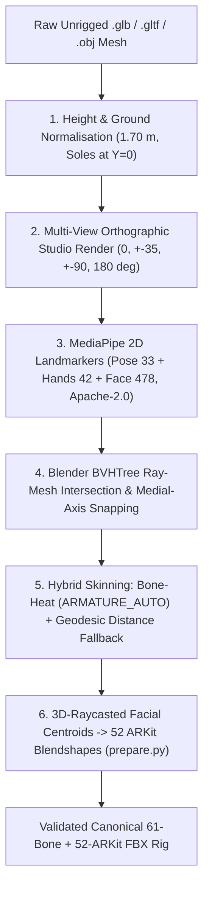

# `v2bm` Native Auto-Rigging Roadmap (`v2bm/rig/autorig.py`)

This document records the architectural specification for a future **native standalone auto-rigger** within [`VideoIntoBlenderModel`](file:///e:/Development/VideoIntoBlenderModel/AGENTS.md) (`v2bm`).

This capability will allow users to pass an **unrigged, static 3D humanoid mesh** (`.glb`, `.gltf`, or `.obj`) directly to `v2bm prepare-rig`:

```powershell
.\venv\Scripts\python.exe -m v2bm.cli prepare-rig `
  --input "assets/models/raw_character.glb" `
  --output "assets/rigs/custom_character.fbx"
```

with **zero external ComfyUI auto-rigging nodes, zero extra cloud services, and zero additional ML weights**.

---

## 1. Architectural Pipeline



---

## 2. Technical Specification

### Stage 1: Scale & Ground Normalisation
- Compute the imported mesh's axial bounding box.
- Scale the mesh so anatomical height is normalised to ~`1.70 m` with the soles grounded at $Y=0$ cm and hips centred at $X=0, Z=0$.

### Stage 2: Multi-View Orthographic Render Pass
- In headless Blender, configure an unlit albedo studio camera.
- Render 8 orthographic or low-FOV perspective views (`0°`, `±35°`, `±90°`, `180°`).
- High-contrast albedo rendering ensures baked diffuse textures, eyes, mouth seams, and boots are sharply legible to vision landmarker models.

### Stage 3: Bundled MediaPipe 2D Landmark Detection (`Apache-2.0`)
- Execute our existing Google MediaPipe models:
  - `pose_landmarker_full.task` (33 body joints)
  - `hand_landmarker.task` (21 joints per hand)
  - `face_landmarker.task` (478 facial landmarks)
- **Orientation Determination**: Compare facial and toe landmarks across views to resolve canonical character facing direction ($+Z$ front, $+Y$ up, $+X$ left), auto-rotating the mesh if it was authored in a non-standard orientation.

### Stage 4: Blender `BVHTree` 3D Ray-Mesh Intersection & Medial-Axis Snapping
- Construct a `mathutils.bvhtree.BVHTree` from the character mesh triangles.
- For each detected 2D joint $(u, v)$ across camera views, cast camera rays into the 3D mesh.
- Compute the entry hit $p_{\text{entry}}$ and exit hit $p_{\text{exit}}$.
- Position each joint at the midpoint $\frac{1}{2}(p_{\text{entry}} + p_{\text{exit}})$, refined by the cross-sectional slice centroid perpendicular to the limb axis. This guarantees that all 61 bone heads (`Hips`, `Spine`, `Neck`, `Head`, shoulders, elbows, wrists, hips, knees, ankles, toes, twist bones, and fingers) sit dead-centre within the volumetric interior of the limbs and torso.

### Stage 5: Hybrid Skinning (`ARMATURE_AUTO` + Geodesic Distance Field Fallback)
- Execute mesh pre-cleaning (`merge_by_distance` and normal recalculation) to repair non-manifold pockets common in generative AI 3D outputs.
- Execute Blender's native bone-heat solver (`bpy.ops.object.parent_set(type='ARMATURE_AUTO')`).
- For any unweighted vertices or disconnected islands (e.g., visors, belts, hair tufts, or boots that fail bone-heat propagation), fall back to a smooth bone-segment distance field, guaranteeing that 100% of vertices satisfy partition of unity across the 61 canonical bones.

### Stage 6: 3D-Raycasted Facial Centroids for 52 ARKit Blendshapes
- Project the 2D MediaPipe Face landmarks (`jaw`, `mouth_l/r`, `eyelid_l/r`, `eyebrow_l/r`, `eye_l/r`) directly onto the 3D head mesh surface.
- Pass these exact 3D coordinates into [`compute_arkit_morph_deltas()`](../v2bm/rig/prepare.py) in place of bounding-box approximations, synthesizing Basis + 52 canonical ARKit blendshapes locked to the character's facial features.

---

## 3. Commercial Licence Compliance

- Uses Google MediaPipe (`Apache-2.0`), Blender Python API (`GPL-3.0`), NumPy (`BSD-3-Clause`), and SciPy (`BSD-3-Clause`).
- Completely free from non-commercial academic research licences (such as SMPL, MPI, or legacy non-commercial detectors).
