# ComfyUI 3D Character Generation & Auto-Rigging Implementation Plan

This plan specifies the end-to-end integration between the ComfyUI 2D-to-3D generation graph (`Image 2 3d model.json`) and [`VideoIntoBlenderModel`](file:///e:/Development/VideoIntoBlenderModel/AGENTS.md) (`v2bm`).

It strictly adheres to all established project conventions:
- **Licence Register Standard**: 100% commercial-permissive (MIT, Apache-2.0, GPL-3.0, CC0) per [`assets/LICENCES.md`](file:///e:/Development/VideoIntoBlenderModel/assets/LICENCES.md).
- **Canonical Kinematics Standard**: Zero rest FK error (`verify_rest_fk` = 0.0), uniform `+Y` edit bone tails (`+5.0 cm`, `roll = 0.0`), and identity `PreRotation`.
- **Single Source of Truth for Bone Aliasing**: Reuses [`HUMANOID_BONE_ALIASES`](file:///e:/Development/VideoIntoBlenderModel/v2bm/rig/fbx_skeleton.py#L139-L960) from [`v2bm/rig/fbx_skeleton.py`](file:///e:/Development/VideoIntoBlenderModel/v2bm/rig/fbx_skeleton.py) rather than duplicating partial dictionaries.
- **Partition of Unity & Facial Locking**: Strictly $\sum w = 1.0$ across canonical 61 bones, with anterior facial geometry rigidly locked to `rig:Head`.
- **Rig Verification Standard**: Every prepared asset must pass [`checks.check_rig()`](file:///e:/Development/VideoIntoBlenderModel/v2bm/checks.py#L472-L531).
- **Environment & Execution Standards**: Headless Blender 5.2.2 LTS execution, Windows PowerShell virtual environment standards (`.\venv\Scripts\python.exe`, `.\venv\Scripts\pytest.exe`), and British English spelling throughout.

---

## 1. Commercial Licence Verification

Every component across both ComfyUI and `v2bm` is verified for commercial use:

| Component | Repository / Author | Licence (SPDX) | Commercial Use |
| :--- | :--- | :---: | :---: |
| **`BiRefNet`** (Background Removal) | `Comfy-Org/BiRefNet` | `MIT` | Permitted |
| **`MoGe-2`** (Normals & FOV) | `Comfy-Org/MoGe` | `MIT` | Permitted |
| **`Pixal3D` & `TRELLIS.2`** (Shape/Texture) | `Comfy-Org/Pixal3D` & `Comfy-Org/TRELLIS.2` | `MIT` | Permitted |
| **`Make-It-Animatable` & `UniRig`** | `PozzettiAndrea/ComfyUI-UniRig` | `MIT` | Permitted |
| **Google MediaPipe** | Google LLC | `Apache-2.0` | Permitted |
| **Blender LTS (`bpy`)** | Blender Foundation | `GPL-3.0-or-later` | Permitted (Outputs Unrestricted) |

---

## 2. End-to-End Pipeline Architecture

```mermaid
flowchart TD
    subgraph ComfyUI["1. ComfyUI 3D Generation & Auto-Rigging (Image 2 3d model.json)"]
        N122["Node 122: LoadImage (Plunger removed, arm-to-torso gap)"] --> N192["Node 192: RemoveBackground (BiRefNet)"]
        N192 --> N312["Node 312: ImageCropToMask (1024x1024)"]
        N312 --> N56["Node 56: MoGeInference (Normals & FOV)"]
        N56 --> N298["Node 298/299: Pixal3D / Trellis2 Conditioning"]
        N298 --> N119["Node 119: VaeDecodeStructureTrellis2"]
        N119 --> N92["Node 92: VaeDecodeShapeTrellis (1536 Upsample)"]
        N92 --> N241["Node 241: RemeshMesh (High-Res Reference)"]
        N241 --> N186["Node 186: DecimateMesh (Lower 700k -> 40k faces)"]
        N186 --> N238["Node 238: MeshSmoothNormals"]
        N238 --> N196["Node 196: UnwrapMesh (2048 UV Atlas)"]
        N196 --> N147["Node 147: BakeTextureFromVoxel (BaseColor, Metallic, Roughness)"]
        N196 --> N224["Node 224: BakeNormalMapFromMesh (From Node 241 Reference)"]
        N196 --> N233["Node 233: BakeAmbientOcclusion"]
        N147 --> N210["Node 210: ApplyTextureToMesh"]
        N224 --> N210
        N233 --> N210
        N210 --> N260["Node 260: MeshSmoothNormals"]
        N260 --> N285["Node 285: MeshToFile3D (.glb)"]
        N285 --> M1["MIALoadModel + MIAAutoRig (reset_to_rest=True, no_fingers=False)"]
        M1 --> M2["Exported Mixamo-Compatible Rigged .fbx / .glb"]
    end
    subgraph V2BM["2. v2bm Canonical Rig Conversion (prepare.py)"]
        M2 --> V1["v2bm/rig/prepare.py: Import .fbx / .glb & Strip Prefix"]
        V1 --> V2["Map Bones via HUMANOID_BONE_ALIASES (Core 22 + 30 Fingers)"]
        V2 --> V3["Synthesise 52 ARKit Blendshapes (Basis + Apple ARKit Standard)"]
        V3 --> V4["Normalise Partition of Unity (sum w = 1.0) & Lock Anterior Face to rig:Head"]
        V4 --> V5["Align Bone Tails to +Y (5.0 cm, roll=0) for Zero Rest FK Error"]
        V5 --> V6["Export Binary FBX & Auto-Discover/Pack Companion PNG Diffuse Texture"]
        V6 --> V7["checks.check_rig() Validation Pass"]
    end
    subgraph Motion["3. Motion Retargeting & Render (v2bm run)"]
        V7 --> R1["v2bm run --skeleton outputs/.../skeleton_motion.npz --rig assets/rigs/attractor_mechanic.fbx"]
        R1 --> R2["Headless Blender OptiX Studio Render (blender_character_render.mp4)"]
        R2 --> R3["Sync to Google Drive (G:/My Drive/.../VideoIntoBlenderModel/)"]
    end
```



---

## 3. Part A: ComfyUI Workflow Tuning (`Image 2 3d model.json`)

1. **Remove Occluding Props (`Node 122 LoadImage`)**:
   - Provide the mechanic illustration without the plunger, with arms slightly apart from the body (an A-pose, T-pose, or open standing stance).
   - This ensures `VoxelToMesh` (`Node 4`) and `RemeshMesh` (`Node 241`) generate distinct meshes for the arms and torso without geometry fusion.
2. **Decimation Target Optimization (`Node 186 DecimateMesh`)**:
   - Change `target_face_count` from `700000` to **`40000`** (35k–50k triangles).
   - The workflow already bakes high-frequency normals (`Node 224`) and ambient occlusion (`Node 233`) from the full-resolution `RemeshMesh` (`Node 241` via `reference_mesh` link `1167`). Lowering the triangle count cuts file size from 63 MB to ~6 MB and eliminates non-manifold skinning weight artefacts.
3. **Append `ComfyUI-UniRig` (`Make-It-Animatable`) Nodes**:
   - Install [`PozzettiAndrea/ComfyUI-UniRig`](https://github.com/PozzettiAndrea/ComfyUI-UniRig) in `ComfyUI/custom_nodes/`.
   - Wire the mesh output into:
     - **`MIALoadModel`**: Loads the MIT-licensed MIA humanoid model.
     - **`MIAAutoRig`**:
       - `reset_to_rest = True` (transforms the character into a canonical Mixamo T-pose).
       - `no_fingers = False` (generates full 30-bone hand skeletons).
   - Export the rigged `.fbx` (or `.glb`).

---

## 4. Part B: `v2bm` Code Updates ([prepare.py](file:///e:/Development/VideoIntoBlenderModel/v2bm/rig/prepare.py) & [cli.py](file:///e:/Development/VideoIntoBlenderModel/v2bm/cli.py))

### 4.1. Unify Bone Aliasing with `fbx_skeleton.py`
- Rather than maintaining an incomplete local `BONE_RENAME_MAP` in [`v2bm/rig/prepare.py`](file:///e:/Development/VideoIntoBlenderModel/v2bm/rig/prepare.py#L91-L186), import and extend [`HUMANOID_BONE_ALIASES`](file:///e:/Development/VideoIntoBlenderModel/v2bm/rig/fbx_skeleton.py#L139-L960) from [`v2bm/rig/fbx_skeleton.py`](file:///e:/Development/VideoIntoBlenderModel/v2bm/rig/fbx_skeleton.py) as the single source of truth.
- [`HUMANOID_BONE_ALIASES`](file:///e:/Development/VideoIntoBlenderModel/v2bm/rig/fbx_skeleton.py) already contains complete mappings for all 30 phalangeal finger bones across Mixamo, Unreal, Kenney, VRM, and Biped conventions (`lefthandthumb1`…`righthandpinky3`).
- Ensure Mixamo finger-tip leaf bones (`mixamorig:LeftHandThumb4`, etc.) fold into their canonical parent bones in `WEIGHT_FOLD_MAP` without producing unmapped vertex warnings.

### 4.2. Support Rigged `.glb` / `.gltf` Input & Embedded PBR Texture Extraction
- Update [`prepare_rig_in_blender()`](file:///e:/Development/VideoIntoBlenderModel/v2bm/rig/prepare.py#L564-L823) to detect file extension:
  - If `.glb` / `.gltf`: invoke `bpy.ops.import_scene.gltf(filepath=...)`.
  - If `.fbx`: invoke `bpy.ops.import_scene.fbx(filepath=...)`.
- If no external companion diffuse image is discovered on disk (`discover_diffuse_texture()` returns `None`), automatically extract the embedded glTF PBR base-colour image from the Blender material node tree, save it to `<output_stem>.png`, and pack it into the exported binary FBX.
- Update CLI help text in [`v2bm/cli.py`](file:///e:/Development/VideoIntoBlenderModel/v2bm/cli.py) so `v2bm prepare-rig --input` specifies `.fbx`, `.glb`, or `.gltf`.

### 4.3. Automated Test Suite & Regression Checks
- Add unit tests in `tests/test_prepare_rig.py` verifying:
  - Bone aliasing covers all 52 Mixamo body and finger bones.
  - Headless Blender preparation executes cleanly on both `.fbx` and `.glb` inputs.
  - Exported rig passes [`checks.check_rig()`](file:///e:/Development/VideoIntoBlenderModel/v2bm/checks.py#L472-L531) with zero rest FK error and verified partition of unity.
- Execute full test suite via canonical PowerShell command:
  ```powershell
  .\venv\Scripts\pytest.exe -v tests/test_prepare_rig.py tests/test_fbx_aliases.py
  ```
